# DL Environment Setup and Reproducibility

**Level:** Beginner · **Stack:** Docker, Python 3.11.9, PyTorch 2.3.1 (CPU)

---

## 1. Introduction

### 1.1 Real-World Scenario

**ShasthyoLens** is a health-tech startup that reads handwritten digits (age, ward, bed number) on scanned patient forms using a small CNN. Two engineers trained the model from the **same commit** and got **different loss curves and accuracies**. The hospital auditor asked: *"If you can't produce the same model twice, which one did you deploy?"*

The causes were different library versions on each laptop, no random seed, and non-deterministic algorithms. Your job is to fix all three and prove it.

### 1.2 Problem Statement

Build a Dockerised PyTorch training pipeline that pins its environment, seeds every RNG, enables deterministic ops, and **proves that two runs produce bit-identical loss curves and weights**.

### 1.3 Learning Outcomes

- Identify where randomness enters a DL training run.
- Pin Python and library versions in a Docker image.
- Seed Python, NumPy and PyTorch RNGs, including DataLoader workers.
- Enable deterministic cuDNN/PyTorch ops.
- Verify reproducibility exactly with hex losses and a weight hash.

### 1.4 Architecture Diagram

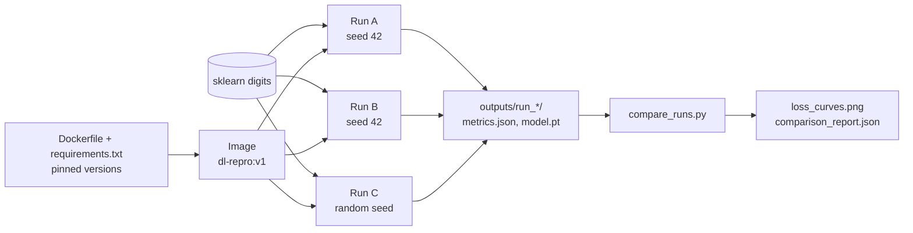

*Figure 1: High-level architecture of the lab.*

### 1.5 Architecture Walkthrough

The **Dockerfile** pins Python 3.11.9 and every library, so everyone trains in one identical environment. The image trains a CNN on the **scikit-learn digits** dataset (1,797 images of 8×8 pixels, bundled offline) three times. **Run A** and **Run B** use seed 42 with determinism on. **Run C** uses a random seed, like the original broken setup. Each run saves its per-step losses in exact **hex** form plus a **SHA-256 hash** of the weights. **`compare_runs.py`** checks them bit-for-bit and plots the curves.

---

## 2. Project Structure

```text
dl-reproducibility/
├── Dockerfile            # pinned base image + determinism env vars
├── .dockerignore
├── requirements.txt      # exact library versions
├── src/
│   ├── __init__.py
│   ├── reproducibility.py  # seeding, determinism, weight hash, env report
│   ├── data.py             # fixed split + seeded DataLoader
│   ├── model.py            # small CNN
│   ├── train.py            # training entry point
│   └── compare_runs.py     # bit-level comparison + plot
├── outputs/              # run results (mounted into the container)
└── docs/images/          # screenshots
```

---

## 3. Prerequisites

| Requirement | Purpose / Version |
|---|---|
| VS Code Server (Poridhi) | Editor + integrated terminal |
| Docker Engine | Build/run the image (tested on 29.7.2) |
| Internet access | Pull `python:3.11.9-slim-bookworm` and the pip packages |
| Python libraries | Installed **inside** the image, not on the host |

Basic Python, CNNs and Docker are enough. A CPU is sufficient; this lab ran on a 2-vCPU, 2 GB RAM VM.

---

## 4. Environment Setup

1. Open the terminal: **Terminal → New Terminal**. If VS Code shows *Restricted Mode*, click **Trust Folder & Continue**.
2. Check Docker:

```bash
docker --version
docker info --format '{{.ServerVersion}}'
```

3. Create the project:

```bash
mkdir -p ~/code/dl-reproducibility/{src,outputs,docs/images}
cd ~/code/dl-reproducibility
```

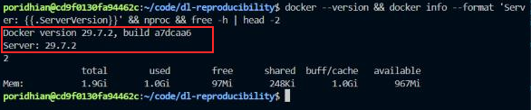

*Figure 2: Docker client and server versions, CPU count and memory.*

The red box shows that both the Docker client and the daemon (server 29.7.2) respond, so images can be built. The VM has 2 vCPUs and about 2 GB RAM, which is enough for this small CNN. Host Python is not used for training; everything runs inside the pinned image.

Create each file below in VS Code (**Explorer → New File**), paste the content and save.

---

## 5. Project Implementation

### Step 1 — Pin the Environment

**Objective:** freeze OS, Python and library versions. Different versions were the first cause of the incident.

**`requirements.txt`**

```text
--extra-index-url https://download.pytorch.org/whl/cpu
torch==2.3.1+cpu
numpy==1.26.4
scikit-learn==1.5.0
matplotlib==3.9.0
```

**`Dockerfile`**

```dockerfile
FROM python:3.11.9-slim-bookworm

# Determinism-related environment (must exist before Python/CUDA start)
ENV PYTHONDONTWRITEBYTECODE=1 \
    PYTHONUNBUFFERED=1 \
    PYTHONHASHSEED=42 \
    CUBLAS_WORKSPACE_CONFIG=:4096:8 \
    OMP_NUM_THREADS=1 \
    MKL_NUM_THREADS=1 \
    MPLCONFIGDIR=/tmp/matplotlib

WORKDIR /app
COPY requirements.txt .
RUN pip install --no-cache-dir -r requirements.txt
COPY src/ ./src/

CMD ["python", "-m", "src.train", "--help"]
```

**`.dockerignore`**

```text
outputs/
docs/
**/__pycache__/
*.md
```

- Exact tags (`3.11.9-slim-bookworm`, `==`) never drift the way `latest` does.
- `+cpu` installs the small CPU build of PyTorch.
- `PYTHONHASHSEED` and `CUBLAS_WORKSPACE_CONFIG` must be set before Python starts. `OMP_NUM_THREADS=1` fixes the CPU thread count, because parallel float sums can change with the number of threads.

### Step 2 — Reproducibility Utilities

**Objective:** control every source of randomness in one module.

Create an empty **`src/__init__.py`**, then **`src/reproducibility.py`**:

```python
"""Reproducibility helpers: seeding, determinism, weight hashing, env report."""
import hashlib
import json
import os
import platform
import random

import numpy as np
import torch


def set_global_seed(seed: int) -> None:
    """Seed Python, NumPy and PyTorch (CPU + all GPUs) RNGs."""
    random.seed(seed)
    np.random.seed(seed)
    torch.manual_seed(seed)
    torch.cuda.manual_seed_all(seed)


def enable_determinism() -> None:
    """Force deterministic cuDNN / PyTorch algorithms."""
    os.environ.setdefault("CUBLAS_WORKSPACE_CONFIG", ":4096:8")
    torch.backends.cudnn.deterministic = True
    torch.backends.cudnn.benchmark = False
    torch.use_deterministic_algorithms(True)


def seed_worker(worker_id: int) -> None:
    """DataLoader worker_init_fn: seed NumPy/random inside each worker."""
    worker_seed = torch.initial_seed() % 2**32
    np.random.seed(worker_seed)
    random.seed(worker_seed)


def make_generator(seed: int) -> torch.Generator:
    """Seeded generator that fixes the DataLoader shuffle order."""
    g = torch.Generator()
    g.manual_seed(seed)
    return g


def state_dict_sha256(model: torch.nn.Module) -> str:
    """SHA-256 fingerprint of every weight (name + raw bytes)."""
    digest = hashlib.sha256()
    for name, tensor in sorted(model.state_dict().items()):
        digest.update(name.encode("utf-8"))
        digest.update(tensor.detach().cpu().contiguous().numpy().tobytes())
    return digest.hexdigest()


def environment_report() -> dict:
    cuda = torch.cuda.is_available()
    return {
        "python": platform.python_version(),
        "torch": torch.__version__,
        "numpy": np.__version__,
        "cuda_available": cuda,
        "cudnn_version": torch.backends.cudnn.version() if cuda else None,
        "torch_num_threads": torch.get_num_threads(),
        "PYTHONHASHSEED": os.environ.get("PYTHONHASHSEED"),
        "CUBLAS_WORKSPACE_CONFIG": os.environ.get("CUBLAS_WORKSPACE_CONFIG"),
        "deterministic_algorithms": torch.are_deterministic_algorithms_enabled(),
        "cudnn_deterministic": torch.backends.cudnn.deterministic,
        "cudnn_benchmark": torch.backends.cudnn.benchmark,
    }


if __name__ == "__main__":
    print("Before enable_determinism():")
    print(json.dumps(environment_report(), indent=2))
    enable_determinism()
    print("After enable_determinism():")
    print(json.dumps(environment_report(), indent=2))
```

| Control | What it fixes |
|---|---|
| `torch.manual_seed` | Weight init, dropout masks, shuffling |
| `seed_worker` + `make_generator` | Randomness inside DataLoader worker processes |
| `cudnn.benchmark = False` | Stops cuDNN from auto-picking a different kernel each run |
| `use_deterministic_algorithms(True)` | Raises an error instead of silently running a non-deterministic op |
| `state_dict_sha256` | One string that changes if any weight bit changes |

### Step 3 — Seeded Data Pipeline

**Objective:** the same split and the same batch order on every run.

**`src/data.py`**

```python
"""Data pipeline: scikit-learn digits (bundled, offline) -> seeded PyTorch DataLoaders."""
import numpy as np
import torch
from sklearn.datasets import load_digits
from sklearn.model_selection import train_test_split
from torch.utils.data import DataLoader, TensorDataset

from src.reproducibility import make_generator, seed_worker


def load_digit_datasets(split_seed: int, val_fraction: float = 0.2):
    """Return (train_ds, val_ds). The split depends only on split_seed."""
    digits = load_digits()                              # 1,797 images, 8x8, values 0..16
    images = (digits.images / 16.0).astype(np.float32)  # scale to [0, 1]
    labels = digits.target.astype(np.int64)
    x_train, x_val, y_train, y_val = train_test_split(
        images, labels, test_size=val_fraction, random_state=split_seed, stratify=labels
    )

    def to_dataset(x, y):
        # (N, 8, 8) -> (N, 1, 8, 8)
        return TensorDataset(torch.from_numpy(x).unsqueeze(1), torch.from_numpy(y))

    return to_dataset(x_train, y_train), to_dataset(x_val, y_val)


def build_dataloaders(batch_size: int, split_seed: int, loader_seed: int, num_workers: int):
    train_ds, val_ds = load_digit_datasets(split_seed)
    train_loader = DataLoader(
        train_ds,
        batch_size=batch_size,
        shuffle=True,
        num_workers=num_workers,
        worker_init_fn=seed_worker,             # seeds each worker process
        generator=make_generator(loader_seed),  # fixes the shuffle order
    )
    val_loader = DataLoader(val_ds, batch_size=256, shuffle=False, num_workers=0)
    return train_loader, val_loader
```

The split seed is kept separate from the training seed, so Run C changes only the training randomness, not the validation set.

### Step 4 — CNN Model

**`src/model.py`**

```python
"""Small CNN for 8x8 single-channel digit images."""
import torch.nn as nn


class DigitsCNN(nn.Module):
    def __init__(self, num_classes: int = 10, dropout: float = 0.25):
        super().__init__()
        self.features = nn.Sequential(
            nn.Conv2d(1, 16, kernel_size=3, padding=1),   # (1, 8, 8)  -> (16, 8, 8)
            nn.ReLU(),
            nn.Conv2d(16, 32, kernel_size=3, padding=1),  # (16, 8, 8) -> (32, 8, 8)
            nn.ReLU(),
            nn.MaxPool2d(2),                              # -> (32, 4, 4)
            nn.Dropout(dropout),
        )
        self.classifier = nn.Sequential(
            nn.Flatten(),                                 # 32 * 4 * 4 = 512
            nn.Linear(32 * 4 * 4, 64),
            nn.ReLU(),
            nn.Dropout(dropout),
            nn.Linear(64, num_classes),
        )

    def forward(self, x):
        return self.classifier(self.features(x))


def count_parameters(model: nn.Module) -> int:
    return sum(p.numel() for p in model.parameters() if p.requires_grad)
```

The model has 38,282 parameters. Dropout uses a new random mask at every step, which makes the effect of seeding easy to see.

### Step 5 — Training Script

**Objective:** train, record every step loss in exact hex form, hash the weights, and save everything.

**`src/train.py`**

```python
"""Training entry point.

  python -m src.train --run-name run_a --seed 42       # controlled run
  python -m src.train --run-name run_c --random-seed   # uncontrolled baseline
"""
import argparse
import json
import os
import time
from pathlib import Path

import torch
import torch.nn as nn

from src.data import build_dataloaders
from src.model import DigitsCNN, count_parameters
from src.reproducibility import enable_determinism, environment_report, set_global_seed, state_dict_sha256


def parse_args():
    p = argparse.ArgumentParser(description="Reproducible CNN training on scikit-learn digits")
    p.add_argument("--run-name", required=True)
    seed_group = p.add_mutually_exclusive_group()
    seed_group.add_argument("--seed", type=int, default=42)
    seed_group.add_argument("--random-seed", action="store_true", help="OS-random seed, determinism OFF")
    p.add_argument("--split-seed", type=int, default=42)
    p.add_argument("--epochs", type=int, default=15)
    p.add_argument("--batch-size", type=int, default=64)
    p.add_argument("--lr", type=float, default=1e-3)
    p.add_argument("--num-workers", type=int, default=2)
    p.add_argument("--threads", type=int, default=1)
    p.add_argument("--device", choices=["cpu", "cuda"], default="cpu")
    p.add_argument("--output-dir", default="outputs")
    return p.parse_args()


def evaluate(model, loader, criterion, device):
    model.eval()
    total_loss, correct, count = 0.0, 0, 0
    with torch.no_grad():
        for images, labels in loader:
            images, labels = images.to(device), labels.to(device)
            logits = model(images)
            total_loss += criterion(logits, labels).item() * labels.size(0)
            correct += (logits.argmax(dim=1) == labels).sum().item()
            count += labels.size(0)
    return total_loss / count, correct / count


def main():
    args = parse_args()
    if args.device == "cuda" and not torch.cuda.is_available():
        raise SystemExit("--device cuda requested but CUDA is not available.")
    torch.set_num_threads(args.threads)

    if args.random_seed:
        seed = int.from_bytes(os.urandom(4), "little")  # different every run
        set_global_seed(seed)
        deterministic = False
    else:
        seed = args.seed
        set_global_seed(seed)
        enable_determinism()
        deterministic = True

    device = torch.device(args.device)
    train_loader, val_loader = build_dataloaders(args.batch_size, args.split_seed, seed, args.num_workers)
    model = DigitsCNN().to(device)
    criterion = nn.CrossEntropyLoss()
    optimizer = torch.optim.Adam(model.parameters(), lr=args.lr)
    tag = f"[{args.run_name}]"
    print(f"{tag} seed={seed} deterministic={deterministic} device={device} "
          f"params={count_parameters(model)} batches/epoch={len(train_loader)}")

    step_losses, epoch_metrics = [], []
    start = time.perf_counter()
    for epoch in range(1, args.epochs + 1):
        model.train()
        running, seen = 0.0, 0
        for images, labels in train_loader:
            images, labels = images.to(device), labels.to(device)
            optimizer.zero_grad(set_to_none=True)
            loss = criterion(model(images), labels)
            loss.backward()
            optimizer.step()
            value = loss.item()
            step_losses.append(value)
            running += value * labels.size(0)
            seen += labels.size(0)
        val_loss, val_acc = evaluate(model, val_loader, criterion, device)
        epoch_metrics.append({"epoch": epoch, "train_loss": running / seen,
                              "val_loss": val_loss, "val_accuracy": val_acc})
        print(f"{tag} epoch {epoch:02d}/{args.epochs} | train_loss {running / seen:.6f} "
              f"| val_loss {val_loss:.6f} | val_acc {val_acc:.4f}")

    train_seconds = time.perf_counter() - start
    model_hash = state_dict_sha256(model)
    run_dir = Path(args.output_dir) / args.run_name
    run_dir.mkdir(parents=True, exist_ok=True)
    torch.save(model.state_dict(), run_dir / "model.pt")
    metrics = {
        "run_name": args.run_name,
        "seed": seed,
        "deterministic": deterministic,
        "config": vars(args),
        "environment": environment_report(),
        "num_parameters": count_parameters(model),
        "num_steps": len(step_losses),
        "step_losses_hex": [float.hex(v) for v in step_losses],  # exact bit pattern
        "epoch_metrics": epoch_metrics,
        "final_val_accuracy": epoch_metrics[-1]["val_accuracy"],
        "model_sha256": model_hash,
        "train_seconds": round(train_seconds, 3),
    }
    with open(run_dir / "metrics.json", "w") as f:
        json.dump(metrics, f, indent=2)

    print(f"{tag} final step loss = {step_losses[-1]!r} (hex {float.hex(step_losses[-1])})")
    print(f"{tag} model sha256    = {model_hash}")
    print(f"{tag} train time      = {train_seconds:.2f}s")
    print(f"{tag} saved           -> {run_dir}/metrics.json, model.pt")


if __name__ == "__main__":
    main()
```

The losses are saved as **hex** because a decimal value rounded to 6 digits can hide a difference in the 10th digit. `float.hex()` stores the exact bit pattern of each loss.

### Step 6 — Comparison Script

**Objective:** turn "the curves look the same" into an exact pass/fail check.

**`src/compare_runs.py`**

```python
"""Compare runs bit-for-bit against the first run and plot their loss curves.

  python -m src.compare_runs outputs/run_a outputs/run_b outputs/run_c
"""
import argparse
import json
from pathlib import Path

import matplotlib

matplotlib.use("Agg")  # headless backend
import matplotlib.pyplot as plt  # noqa: E402


def load_run(run_dir):
    path = Path(run_dir) / "metrics.json"
    if not path.exists():
        raise SystemExit(f"metrics.json not found in {run_dir}. Train that run first.")
    return json.loads(path.read_text())


def compare(ref, other):
    a, b = ref["step_losses_hex"], other["step_losses_hex"]
    n = min(len(a), len(b))
    mismatched = [i for i in range(n) if a[i] != b[i]]
    max_diff = max((abs(float.fromhex(a[i]) - float.fromhex(b[i])) for i in range(n)), default=0.0)
    hash_match = ref["model_sha256"] == other["model_sha256"]
    return {
        "run": other["run_name"],
        "seed": other["seed"],
        "mismatched_steps": len(mismatched),
        "first_mismatch_step": mismatched[0] if mismatched else None,
        "max_abs_loss_diff": max_diff,
        "model_hash_match": hash_match,
        "final_val_accuracy": other["final_val_accuracy"],
        "bit_identical": len(a) == len(b) and not mismatched and hash_match,
    }


def plot(runs, out_path):
    ref = [float.fromhex(h) for h in runs[0]["step_losses_hex"]]
    styles = ["-", "--", ":", "-."]
    fig, (ax1, ax2) = plt.subplots(2, 1, figsize=(10, 7), sharex=True, gridspec_kw={"height_ratios": [3, 2]})
    for i, run in enumerate(runs):
        vals = [float.fromhex(h) for h in run["step_losses_hex"]]
        label = "{} (seed={}, deterministic={})".format(run["run_name"], run["seed"], run["deterministic"])
        ax1.plot(vals, styles[i % 4], linewidth=3 if i == 0 else 1.5, alpha=0.5 if i == 0 else 1, label=label)
        if i > 0:
            ax2.plot([abs(v - r) for v, r in zip(vals, ref)], styles[i % 4], label="|{} - {}|".format(run["run_name"], runs[0]["run_name"]))
    ax1.set_title("Training loss per step")
    ax1.set_ylabel("loss")
    ax1.legend()
    ax1.grid(alpha=0.3)
    ax2.set_xlabel("training step")
    ax2.set_ylabel("abs diff vs reference")
    ax2.legend()
    ax2.grid(alpha=0.3)
    fig.tight_layout()
    fig.savefig(out_path, dpi=150)


def main():
    parser = argparse.ArgumentParser(description="Bit-level comparison of training runs")
    parser.add_argument("runs", nargs="+", help="run folders; the first is the reference")
    parser.add_argument("--output-dir", default="outputs/comparison")
    args = parser.parse_args()
    if len(args.runs) < 2:
        raise SystemExit("Give at least two run folders.")

    runs = [load_run(r) for r in args.runs]
    results = [compare(runs[0], other) for other in runs[1:]]
    out_dir = Path(args.output_dir)
    out_dir.mkdir(parents=True, exist_ok=True)
    plot(runs, out_dir / "loss_curves.png")
    report = {"reference": runs[0]["run_name"], "reference_sha256": runs[0]["model_sha256"], "comparisons": results}
    (out_dir / "comparison_report.json").write_text(json.dumps(report, indent=2))

    ref = runs[0]
    print("Reference: {} (seed={}, steps={}, val_acc={:.4f})".format(
        ref["run_name"], ref["seed"], len(ref["step_losses_hex"]), ref["final_val_accuracy"]))
    row = "{:<7} {:>11} {:>11} {:>11} {:>13} {:>11} {:>8}  {}"
    print(row.format("run", "seed", "mismatched", "first_diff", "max_abs_diff", "hash_match", "val_acc", "verdict"))
    for r in results:
        first = "-" if r["first_mismatch_step"] is None else r["first_mismatch_step"]
        verdict = "BIT-IDENTICAL" if r["bit_identical"] else "DIFFERENT"
        print(row.format(r["run"], r["seed"], r["mismatched_steps"], first, "{:.3e}".format(r["max_abs_loss_diff"]),
                         str(r["model_hash_match"]), "{:.4f}".format(r["final_val_accuracy"]), verdict))
    print("Saved: {}, {}".format(out_dir / "loss_curves.png", out_dir / "comparison_report.json"))


if __name__ == "__main__":
    main()
```

### Step 7 — Build the Image and Inspect the Environment

```bash
docker build -t dl-repro:v1 .
docker run --rm dl-repro:v1 python -m src.reproducibility
```

Check that every file is in place before building:

```bash
find . -type f | sort && docker images dl-repro
```

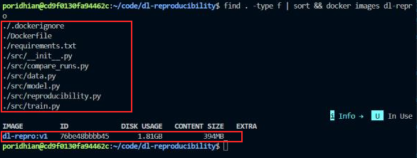

*Figure 3: Project files and the built image `dl-repro:v1`.*

The first box lists the eight source files from Section 2, so nothing is missing from the build context. The second box shows the image `dl-repro:v1` built from them. The disk usage (1.81 GB) is mostly Python and PyTorch, which the image pins once for everyone.

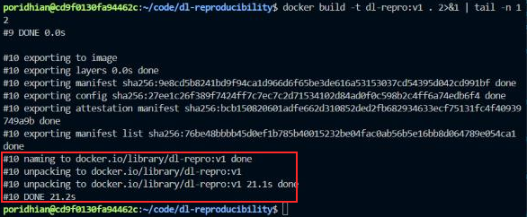

*Figure 4: End of `docker build`.*

The highlighted lines show the image being tagged `dl-repro:v1` and the build finishing. The first build downloads PyTorch and takes a few minutes; later builds reuse the cached dependency layer and finish in seconds. Rebuilding does not change results as long as `requirements.txt` and the base image stay the same.

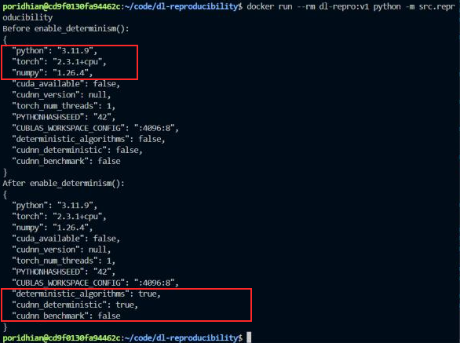

*Figure 5: Environment report inside the container.*

The top box shows the pinned versions: Python 3.11.9, torch 2.3.1+cpu and NumPy 1.26.4. The bottom box shows `enable_determinism()` turning `deterministic_algorithms` and `cudnn_deterministic` to `true` while `cudnn_benchmark` stays `false`. `PYTHONHASHSEED` and `CUBLAS_WORKSPACE_CONFIG` come from the Dockerfile, which shows the image carries its own reproducibility settings.

### Step 8 — Train Run A, Run B and Run C

```bash
docker run --rm --user "$(id -u):$(id -g)" -v "$(pwd)/outputs:/app/outputs" \
  dl-repro:v1 python -m src.train --run-name run_a --seed 42
docker run --rm --user "$(id -u):$(id -g)" -v "$(pwd)/outputs:/app/outputs" \
  dl-repro:v1 python -m src.train --run-name run_b --seed 42
docker run --rm --user "$(id -u):$(id -g)" -v "$(pwd)/outputs:/app/outputs" \
  dl-repro:v1 python -m src.train --run-name run_c --random-seed
```

`-v` keeps the results on the host after the container exits. `--user` makes the output files belong to you instead of root.


*Figure 6: Run A (seed 42, deterministic).*

The top box records the controlled setup: seed 42, `deterministic=True`, 38,282 parameters and 23 batches per epoch. The bottom box is the run's fingerprint: the final step loss in hex and the SHA-256 of all weights. The model reaches 0.9750 validation accuracy in about 6 seconds on the CPU.

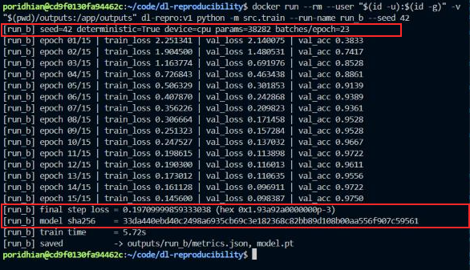

*Figure 7: Run B, a second run with the same seed.*

Every epoch line matches Run A exactly. The boxed hex loss `0x1.93a92a0000000p-3` and hash `33da440e…c59561` are identical to Run A's. Only the training time differs, which is expected because timing is not part of the model.

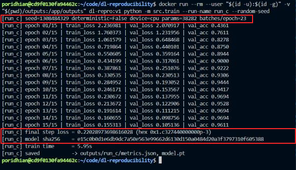

*Figure 8: Run C (random seed, determinism off).*

The top box shows a seed drawn from the OS (1308484329) with `deterministic=False`. The loss values differ from the first epoch, and the boxed hash `e15c0b0d…605388` does not match. Validation accuracy (0.9611) is still good, which is why this problem is easy to miss: both models look valid, but they are different models.

### Step 9 — Compare Bit-for-Bit

```bash
docker run --rm --user "$(id -u):$(id -g)" -v "$(pwd)/outputs:/app/outputs" \
  dl-repro:v1 python -m src.compare_runs outputs/run_a outputs/run_b outputs/run_c
```

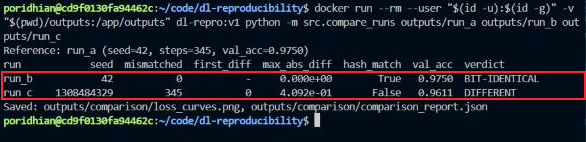

*Figure 9: Bit-level comparison against Run A.*

The boxed rows are the verdict. Run B has 0 mismatched steps out of 345, a maximum difference of `0.000e+00` and a matching hash, so it is **BIT-IDENTICAL**. Run C differs at all 345 steps, starting from step 0, with differences up to 0.409, so it is **DIFFERENT**.

To see the exact numbers behind the verdict, print the first three hex losses of each run:

```bash
python3 -c "import json; [print(r, json.load(open('outputs/'+r+'/metrics.json'))['step_losses_hex'][:3]) for r in ('run_a','run_b','run_c')]"
```

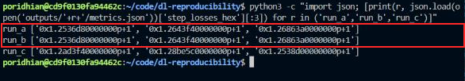

*Figure 10: First three step losses in hex.*

The boxed `run_a` and `run_b` lines match character for character, so the losses are equal at the bit level. `run_c` already differs at step 0, because its initial weights come from a different seed.

```bash
ls -l outputs/*/
```

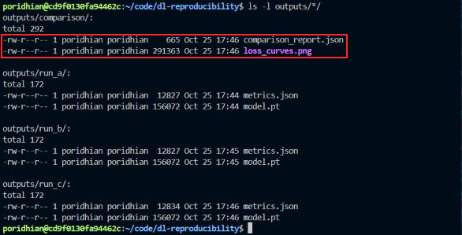

*Figure 11: Files produced by the runs and the comparison.*

Each run folder holds `metrics.json` and `model.pt`. The box marks `comparison_report.json` and `loss_curves.png`, the evidence files for the release report. Open `outputs/comparison/loss_curves.png` from the Explorer to view the plot.

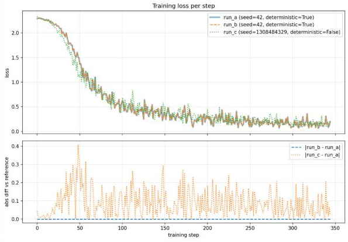

*Figure 12: `loss_curves.png`, training loss per step (top) and absolute difference from Run A (bottom).*

In the top panel, Run B's dashed line sits exactly on Run A's thick line, while Run C's dotted line follows its own path. In the bottom panel, Run B's difference stays at zero for all 345 steps and Run C's jumps as high as 0.4.

---

## 6. Verification and Testing

| Check | Success means |
|---|---|
| Environment report | Python 3.11.9, torch 2.3.1+cpu, numpy 1.26.4. After `enable_determinism()`, the deterministic flags are `true`. |
| Run B vs Run A | `mismatched = 0`, `max_abs_diff = 0`, `hash_match = True`, verdict **BIT-IDENTICAL** |
| Run C vs Run A | Verdict **DIFFERENT**. This proves the check can detect a difference. |
| Output files | `outputs/run_*/metrics.json` and `model.pt` exist |

Exact losses, hashes and accuracy depend on the CPU type. Reproducibility is guaranteed for the **same image on the same hardware type**.

---

## 7. Results and Observations

All values below are from the runs in this lab (2 vCPU VM, Docker 29.7.2).

| Measurement | Run A | Run B | Run C |
|---|---|---|---|
| Seed / deterministic | 42 / True | 42 / True | 1308484329 / False |
| Steps | 345 | 345 | 345 |
| Final val accuracy | 0.9750 | 0.9750 | 0.9611 |
| Final step loss (hex) | `0x1.93a92a0000000p-3` | `0x1.93a92a0000000p-3` | `0x1.c327440000000p-3` |
| Model SHA-256 | `33da440e…c59561` | `33da440e…c59561` | `e15c0b0d…605388` |
| Mismatched steps vs A | — | 0 | 345 (from step 0) |
| Max abs loss diff vs A | — | 0.000 | 0.409 |
| Train time | 6.27 s | 5.72 s | 5.95 s |

- **Seeded runs are bit-identical.** Run A also produced the same hash (`33da440e…`) before and after the image was rebuilt, so the result did not depend on a particular build.
- **The unseeded run is a different model** with similar quality, which is exactly the ShasthyoLens incident.
- **Training time varies** from run to run. It is not part of the reproducibility guarantee.

---

## 8. Troubleshooting

**Terminal won't open / Restricted Mode**
- **Cause:** the workspace is not trusted.
- **Fix:** click **Restricted Mode** in the status bar, then **Trust**.

**`permission denied ... docker.sock`**
- **Cause:** your user is not in the `docker` group.
- **Fix:** use `sudo docker ...`, or run `sudo usermod -aG docker $USER` and open a new terminal.

**`No matching distribution found for torch==2.3.1+cpu`**
- **Cause:** the `--extra-index-url` line is missing, or `download.pytorch.org` is blocked.
- **Fix:** restore the first line of `requirements.txt`, or use `torch==2.3.1` from PyPI (larger download).

**`ModuleNotFoundError: No module named 'src'`**
- **Cause:** `src/__init__.py` is missing, or you ran `python src/train.py`.
- **Fix:** create the empty file, rebuild, and always use `python -m src.<module>`.

**`PermissionError` writing to `outputs/`**
- **Cause:** an earlier container ran as root.
- **Fix:** run `sudo chown -R $(id -u):$(id -g) outputs`, then rerun with `--user`.

**Run A and Run B are DIFFERENT**
- **Cause:** the runs used different `--threads`, `--num-workers` or `--batch-size` values, or the image was rebuilt in between.
- **Fix:** delete both run folders and rerun with identical commands from the same image.

---

## 9. Conclusion

ShasthyoLens's engineers got two different models from one commit because their environments, seeds and algorithm choices were uncontrolled. This lab fixed all three with a pinned Docker image, seeded Python, NumPy, PyTorch and DataLoader-worker RNGs, and deterministic PyTorch/cuDNN settings. The two seeded runs produced bit-identical losses at all 345 steps and the same weight hash (`33da440e…`), while the random-seed run differed from step 0. Because losses are stored in hex and the weights are hashed, reproducibility is a pass/fail check instead of a visual guess. A team can now trace any released model to an image tag, a commit and a seed, and rebuild it exactly on the same hardware type.
