# CNN / RNN / Transformer Architecture Tour

**Level:** Beginner · **Stack:** Docker, Python 3.11.9, PyTorch 2.3.1 (CPU)

---

## 1. Introduction

**ShasthyoLens**, a health-tech startup, now wants three AI features: reading handwritten digits on patient forms, spotting whether a patient's heart rate is **falling, stable or rising**, and **auto-completing clinical notes**. The team has a small CPU budget and asks a simple question: *which neural-network family fits each feature, and what does each one cost?*

You will build one small model from each family (CNN, LSTM, Transformer), train all three in the same pinned Docker image, and measure their size, compute and accuracy.

Implement a toy **CNN** (image classification), **LSTM** (sequence classification) and **Transformer** (masked language modelling) in PyTorch. Compare **parameter counts**, **FLOPs**, training time, accuracy and **use-case fit**, and show how compute grows with sequence length.

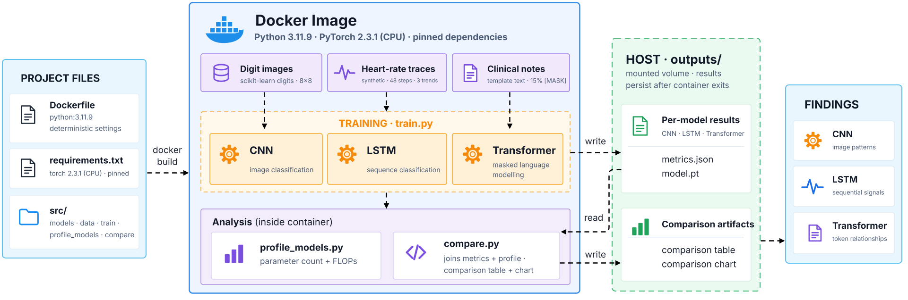

The project files are built into one pinned image, `dl-arch:v1`. Inside it, three **offline** datasets feed three models: digit images → **CNN**, synthetic heart-rate traces → **LSTM**, template clinical notes with 15% `[MASK]` tokens → **Transformer**. Every run uses seed 42.

`train.py` trains each model and **writes** `metrics.json` and `model.pt` to the host folder `outputs/`, which is mounted into the container. `profile_models.py` counts parameters and FLOPs. `compare.py` **reads** everything and **writes** a comparison table and chart. The findings answer ShasthyoLens's question.

**Key ideas in one line each:**

| Family | How it reads data | Cost driver |
|---|---|---|
| **CNN** | Small filters slide over a grid; the same weights are reused at every position | Image size × filters |
| **RNN / LSTM** | One time step at a time, carrying a memory `(h, c)` | Grows **linearly** with sequence length; steps can't run in parallel |
| **Transformer** | Self-attention: every token looks at every other token at once | Attention grows with **length²** |

---

## 2. Objectives

By the end of this lab, you will be able to:

- Explain how CNNs, RNNs/LSTMs and Transformers process data differently.
- Implement a small model of each family in PyTorch.
- Count parameters and measure FLOPs with `torch.utils.flop_counter`.
- Show why LSTM cost grows linearly with sequence length, and attention cost grows faster.
- Pick an architecture family for a given data type and budget.

---

## 3. Project Structure

```text
dl-architecture-tour/
├── Dockerfile               # pinned base image + env vars
├── .dockerignore
├── requirements.txt         # exact versions (CPU PyTorch)
├── src/
│   ├── __init__.py
│   ├── reproducibility.py   # seeding + deterministic ops
│   ├── data.py              # three offline datasets
│   ├── models.py            # CNN, LSTM, Transformer
│   ├── train.py             # trains one model (--model)
│   ├── profile_models.py    # params + FLOPs
│   └── compare.py           # table + chart
├── outputs/                 # results (mounted volume)
└── docs/images/             # screenshots and diagram
```

---

## 4. Prerequisites

| Requirement | Purpose / Version |
|---|---|
| VS Code Server (Poridhi) | Editor + integrated terminal |
| Docker Engine | Build and run the image (tested on 29.7.2) |
| Internet access | Pull `python:3.11.9-slim-bookworm` and the pip packages (build time only) |
| Knowledge | Basic Python and PyTorch; the reproducibility lab is helpful |

No GPU and no dataset download are needed. All data is generated or bundled.

---

## 5. Environment Setup

1. Open the terminal (**Terminal → New Terminal**). If VS Code shows *Restricted Mode*, click **Trust Folder & Continue**.
2. Check Docker and the VM's resources:

```bash
docker --version && docker info --format 'Server: {{.ServerVersion}}' && nproc && free -h | head -2
```

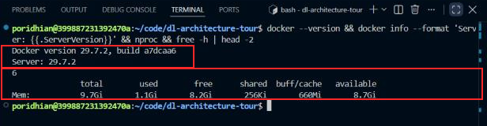

The first box shows that both the Docker client and the daemon (29.7.2) respond. The second box shows 6 CPUs and 9.7 GB RAM on this VM. Training uses a single thread (`OMP_NUM_THREADS=1`), so timings stay comparable between the models, not between machines.

3. Create the project:

```bash
mkdir -p ~/code/dl-architecture-tour/{src,outputs,docs/images}
cd ~/code/dl-architecture-tour
```

Create each file below with **Explorer → New File**, paste the content and save. `src/__init__.py` stays empty.

---

## 6. Project Implementation

### Step 1 — Pin the Environment

**Objective:** one identical environment for all three models, so the comparison is fair.

**`requirements.txt`**

```text
--extra-index-url https://download.pytorch.org/whl/cpu
torch==2.3.1+cpu
numpy==1.26.4
scikit-learn==1.5.0
matplotlib==3.9.0
```

**`Dockerfile`**

```dockerfile
FROM python:3.11.9-slim-bookworm

# Determinism-related environment (must exist before Python starts)
ENV PYTHONDONTWRITEBYTECODE=1 \
    PYTHONUNBUFFERED=1 \
    PYTHONHASHSEED=42 \
    CUBLAS_WORKSPACE_CONFIG=:4096:8 \
    OMP_NUM_THREADS=1 \
    MKL_NUM_THREADS=1 \
    MPLCONFIGDIR=/tmp/matplotlib

WORKDIR /app
COPY requirements.txt .
RUN pip install --no-cache-dir -r requirements.txt
COPY src/ ./src/

CMD ["python", "-m", "src.train", "--help"]
```

**`.dockerignore`**

```text
outputs/
docs/
**/__pycache__/
*.md
```

**`src/reproducibility.py`** (reused from the reproducibility lab)

```python
"""Seeding and determinism helpers (reused from the reproducibility lab)."""
import os
import random

import numpy as np
import torch

def set_global_seed(seed: int) -> None:
    random.seed(seed)
    np.random.seed(seed)
    torch.manual_seed(seed)
    torch.cuda.manual_seed_all(seed)

def enable_determinism() -> None:
    os.environ.setdefault("CUBLAS_WORKSPACE_CONFIG", ":4096:8")
    torch.backends.cudnn.deterministic = True
    torch.backends.cudnn.benchmark = False
    torch.use_deterministic_algorithms(True)
```

### Step 2 — Offline Datasets

**Objective:** three data types, one per architecture family, with no downloads.

- **Digits:** 1,797 handwritten 8×8 images that ship with scikit-learn.
- **Heart-rate traces:** 3,000 synthetic sequences of 48 steps (baseline + trend + breathing wave + noise). The label is the trend: falling, stable or rising.
- **Clinical notes:** 4,000 template sentences such as *"woman complains of chest pain for one week plan refer to cardiology"*. 15% of the words are replaced with `[MASK]`, and the model must predict them. Each symptom has a fixed plan, so the plan words are predictable from context.

**`src/data.py`**

```python
"""Offline datasets for the three architecture families (no downloads)."""
import random

import numpy as np
import torch
from sklearn.datasets import load_digits
from sklearn.model_selection import train_test_split
from torch.utils.data import DataLoader, TensorDataset

SEQ_LEN = 48      # heart-rate sequence length (time steps)
NOTE_LEN = 16     # clinical-note length in tokens (padded)
PAD, MASK = 0, 1  # special token ids

def _loaders(x, y, batch_size, seed, stratify=None):
    x_tr, x_va, y_tr, y_va = train_test_split(x, y, test_size=0.2, random_state=seed, stratify=stratify)
    g = torch.Generator().manual_seed(seed)
    train = DataLoader(TensorDataset(torch.from_numpy(x_tr), torch.from_numpy(y_tr)),
                       batch_size=batch_size, shuffle=True, generator=g)
    val = DataLoader(TensorDataset(torch.from_numpy(x_va), torch.from_numpy(y_va)), batch_size=256)
    return train, val

def digits_loaders(seed, batch_size=64):
    """CNN task: classify 8x8 handwritten digits (0-9)."""
    d = load_digits()
    x = (d.images / 16.0).astype(np.float32)[:, None, :, :]  # (N, 1, 8, 8)
    y = d.target.astype(np.int64)
    return _loaders(x, y, batch_size, seed, stratify=y)

def vitals_loaders(seed, batch_size=64, n=3000):
    """RNN task: label a noisy heart-rate trace as falling (0), stable (1) or rising (2)."""
    rng = np.random.RandomState(seed)
    y = rng.randint(0, 3, size=n).astype(np.int64)
    t = np.arange(SEQ_LEN)
    slope = (y - 1)[:, None] * rng.uniform(0.15, 0.35, size=(n, 1))  # bpm per step
    base = rng.normal(75, 8, size=(n, 1))
    wave = 2.0 * np.sin(2 * np.pi * t / rng.uniform(8, 16, size=(n, 1)))
    hr = base + slope * t + wave + rng.normal(0, 1.5, size=(n, SEQ_LEN))
    x = ((hr - 75) / 10).astype(np.float32)[:, :, None]  # (N, 48, 1)
    return _loaders(x, y, batch_size, seed, stratify=y)

SUBJECTS = ["patient", "child", "woman", "man", "elderly patient"]
VERBS = ["reports", "complains of", "presents with", "has"]
DURATIONS = ["for two days", "for one week", "since yesterday", "since morning"]
PLAN_FOR = {  # each symptom has its own plan, so masked plan words are predictable from context
    "fever": "start paracetamol",
    "cough": "order chest xray",
    "headache": "advise rest",
    "chest pain": "refer to cardiology",
    "nausea": "give oral fluids",
    "back pain": "start physiotherapy",
}

def make_notes(n, seed):
    rng = random.Random(seed)
    notes = []
    for _ in range(n):
        symptom = rng.choice(sorted(PLAN_FOR))
        words = [rng.choice(SUBJECTS), rng.choice(VERBS), symptom, rng.choice(DURATIONS), "plan", PLAN_FOR[symptom]]
        notes.append(" ".join(words).split())
    return notes

def build_vocab():
    words = set()
    for group in (SUBJECTS, VERBS, DURATIONS, list(PLAN_FOR), list(PLAN_FOR.values()), ["plan"]):
        for phrase in group:
            words.update(phrase.split())
    return ["[PAD]", "[MASK]"] + sorted(words)

def notes_loaders(seed, batch_size=64, n=4000, mask_prob=0.15):
    """Transformer task: masked language modelling on short clinical notes."""
    vocab = build_vocab()
    index = {w: i for i, w in enumerate(vocab)}
    rng = np.random.RandomState(seed)
    ids = np.full((n, NOTE_LEN), PAD, dtype=np.int64)
    labels = np.full((n, NOTE_LEN), -100, dtype=np.int64)  # -100 = ignored by the loss
    for i, words in enumerate(make_notes(n, seed)):
        ids[i, :len(words)] = [index[w] for w in words]
        k = max(1, int(round(mask_prob * len(words))))
        pos = rng.choice(len(words), size=k, replace=False)
        labels[i, pos] = ids[i, pos]
        ids[i, pos] = MASK
    train, val = _loaders(ids, labels, batch_size, seed)
    return train, val, len(vocab)
```

### Step 3 — The Three Models

**Objective:** one small, readable model per family, of a similar size.

- **CNN:** two 3×3 convolutions + max-pool + two linear layers.
- **LSTM:** an explicit loop over `nn.LSTMCell`, so you can see that step *t* must wait for step *t−1*.
- **Transformer:** written by hand (embeddings, multi-head self-attention, feed-forward, LayerNorm), so the `(L × L)` attention matrix is visible in the code.

**`src/models.py`**

```python
"""Three small models, one per architecture family."""
import math

import torch
import torch.nn as nn

class DigitsCNN(nn.Module):
    """CNN: small filters slide over the image and share weights across positions."""

    def __init__(self, num_classes=10):
        super().__init__()
        self.features = nn.Sequential(
            nn.Conv2d(1, 16, kernel_size=3, padding=1), nn.ReLU(),   # (1, 8, 8)  -> (16, 8, 8)
            nn.Conv2d(16, 32, kernel_size=3, padding=1), nn.ReLU(),  # (16, 8, 8) -> (32, 8, 8)
            nn.MaxPool2d(2),                                         # -> (32, 4, 4)
        )
        self.head = nn.Sequential(nn.Flatten(), nn.Linear(32 * 4 * 4, 64), nn.ReLU(), nn.Linear(64, num_classes))

    def forward(self, x):
        return self.head(self.features(x))

class VitalsLSTM(nn.Module):
    """RNN/LSTM: reads the sequence one time step at a time and carries a memory (h, c)."""

    def __init__(self, hidden=64, num_classes=3):
        super().__init__()
        self.hidden = hidden
        self.cell = nn.LSTMCell(input_size=1, hidden_size=hidden)
        self.head = nn.Linear(hidden, num_classes)

    def forward(self, x):  # x: (B, L, 1)
        h = x.new_zeros(x.size(0), self.hidden)
        c = x.new_zeros(x.size(0), self.hidden)
        for t in range(x.size(1)):  # sequential: step t needs the result of step t-1
            h, c = self.cell(x[:, t], (h, c))
        return self.head(h)

class SelfAttention(nn.Module):
    """Every token looks at every other token: scores are an (L x L) matrix."""

    def __init__(self, d_model, n_heads):
        super().__init__()
        self.h, self.d = n_heads, d_model // n_heads
        self.qkv = nn.Linear(d_model, 3 * d_model)
        self.out = nn.Linear(d_model, d_model)

    def forward(self, x, pad_mask):
        b, l, dm = x.shape
        q, k, v = self.qkv(x).reshape(b, l, 3, self.h, self.d).permute(2, 0, 3, 1, 4)
        scores = q @ k.transpose(-2, -1) / math.sqrt(self.d)  # (B, heads, L, L)
        scores = scores.masked_fill(pad_mask[:, None, None, :], float("-inf"))
        y = (scores.softmax(dim=-1) @ v).transpose(1, 2).reshape(b, l, dm)
        return self.out(y)

class TransformerBlock(nn.Module):
    def __init__(self, d_model, n_heads, d_ff, dropout):
        super().__init__()
        self.ln1, self.ln2 = nn.LayerNorm(d_model), nn.LayerNorm(d_model)
        self.attn = SelfAttention(d_model, n_heads)
        self.ff = nn.Sequential(nn.Linear(d_model, d_ff), nn.GELU(), nn.Linear(d_ff, d_model))
        self.drop = nn.Dropout(dropout)

    def forward(self, x, pad_mask):
        x = x + self.drop(self.attn(self.ln1(x), pad_mask))
        return x + self.drop(self.ff(self.ln2(x)))

class TinyTransformerMLM(nn.Module):
    """Transformer encoder that predicts the [MASK] tokens of a sentence."""

    def __init__(self, vocab_size, max_len=256, d_model=64, n_heads=4, d_ff=128, n_layers=2, dropout=0.1):
        super().__init__()
        self.tok = nn.Embedding(vocab_size, d_model)
        self.pos = nn.Embedding(max_len, d_model)
        self.blocks = nn.ModuleList([TransformerBlock(d_model, n_heads, d_ff, dropout) for _ in range(n_layers)])
        self.ln = nn.LayerNorm(d_model)
        self.head = nn.Linear(d_model, vocab_size)

    def forward(self, ids):  # ids: (B, L)
        pad_mask = ids == 0
        x = self.tok(ids) + self.pos(torch.arange(ids.size(1)))
        for block in self.blocks:
            x = block(x, pad_mask)
        return self.head(self.ln(x))  # (B, L, vocab)

def build_model(name, vocab_size=None):
    if name == "cnn":
        return DigitsCNN()
    if name == "lstm":
        return VitalsLSTM()
    return TinyTransformerMLM(vocab_size)

def count_parameters(model):
    return sum(p.numel() for p in model.parameters() if p.requires_grad)
```

### Step 4 — Training Script

**Objective:** one script that trains any of the three models with the same seed, optimizer and output format.

For the Transformer, the loss and accuracy use only the masked positions (label `-100` is ignored).

**`src/train.py`**

```python
"""Train one architecture family.

  python -m src.train --model cnn | lstm | transformer
"""
import argparse
import json
import time
from pathlib import Path

import torch
import torch.nn as nn

from src.data import digits_loaders, notes_loaders, vitals_loaders
from src.models import build_model, count_parameters
from src.reproducibility import enable_determinism, set_global_seed

TASKS = {  # task description, epochs, learning rate
    "cnn": ("digit image -> class 0-9", 15, 1e-3),
    "lstm": ("heart-rate sequence -> trend", 15, 3e-3),
    "transformer": ("clinical note -> masked words", 30, 1e-3),
}

def run_epoch(model, loader, criterion, optimizer=None):
    training = optimizer is not None
    model.train(training)
    total_loss, correct, count = 0.0, 0, 0
    with torch.set_grad_enabled(training):
        for x, y in loader:
            logits = model(x)
            if logits.dim() == 3:  # MLM: score only the masked positions
                logits, y = logits.reshape(-1, logits.size(-1)), y.reshape(-1)
                keep = y != -100
                logits, y = logits[keep], y[keep]
            loss = criterion(logits, y)
            if training:
                optimizer.zero_grad(set_to_none=True)
                loss.backward()
                optimizer.step()
            total_loss += loss.item() * y.size(0)
            correct += (logits.argmax(dim=1) == y).sum().item()
            count += y.size(0)
    return total_loss / count, correct / count

def main():
    p = argparse.ArgumentParser(description="Train one architecture family")
    p.add_argument("--model", choices=sorted(TASKS), required=True)
    p.add_argument("--seed", type=int, default=42)
    p.add_argument("--output-dir", default="outputs")
    args = p.parse_args()

    torch.set_num_threads(1)
    set_global_seed(args.seed)
    enable_determinism()

    task, epochs, lr = TASKS[args.model]
    vocab_size = None
    if args.model == "cnn":
        train_loader, val_loader = digits_loaders(args.seed)
    elif args.model == "lstm":
        train_loader, val_loader = vitals_loaders(args.seed)
    else:
        train_loader, val_loader, vocab_size = notes_loaders(args.seed)

    model = build_model(args.model, vocab_size)
    optimizer = torch.optim.Adam(model.parameters(), lr=lr)
    criterion = nn.CrossEntropyLoss()
    tag = f"[{args.model}]"
    print(f"{tag} task: {task} | params={count_parameters(model):,} | batches/epoch={len(train_loader)}")

    start = time.perf_counter()
    for epoch in range(1, epochs + 1):
        train_loss, _ = run_epoch(model, train_loader, criterion, optimizer)
        val_loss, val_acc = run_epoch(model, val_loader, criterion)
        if epoch == 1 or epoch % 5 == 0:
            print(f"{tag} epoch {epoch:02d}/{epochs} | train_loss {train_loss:.4f} | val_loss {val_loss:.4f} | val_acc {val_acc:.4f}")
    seconds = time.perf_counter() - start

    out = Path(args.output_dir) / args.model
    out.mkdir(parents=True, exist_ok=True)
    torch.save(model.state_dict(), out / "model.pt")
    metrics = {"model": args.model, "task": task, "params": count_parameters(model), "epochs": epochs,
               "val_loss": val_loss, "val_accuracy": val_acc, "train_seconds": round(seconds, 2)}
    (out / "metrics.json").write_text(json.dumps(metrics, indent=2))
    print(f"{tag} final val_acc={val_acc:.4f} | train time {seconds:.1f}s | saved -> {out}/metrics.json")

if __name__ == "__main__":
    main()
```

### Step 5 — Profiling Script (Parameters + FLOPs)

**Objective:** measure model size and compute per sample, and how compute grows with sequence length.

`FlopCounterMode` is built into PyTorch. It counts the floating-point operations of matrix multiplies and convolutions during one forward pass (1 multiply-add = 2 FLOPs).

**`src/profile_models.py`**

```python
"""Count parameters and forward-pass FLOPs for one sample of each architecture.

  python -m src.profile_models
"""
import json
from pathlib import Path

import torch
from torch.utils.flop_counter import FlopCounterMode

from src.data import NOTE_LEN, SEQ_LEN, build_vocab
from src.models import build_model, count_parameters

LENGTHS = [16, 32, 64, 128, 256]

def count_flops(model, x):
    with FlopCounterMode(display=False) as counter:
        model(x)
    return counter.get_total_flops()

def sample(name, length):
    if name == "cnn":
        return torch.zeros(1, 1, 8, 8)
    if name == "lstm":
        return torch.zeros(1, length, 1)
    return torch.full((1, length), 2, dtype=torch.long)  # any real (non-pad) token id

def main():
    torch.manual_seed(42)
    vocab_size = len(build_vocab())
    models = {name: build_model(name, vocab_size).eval() for name in ("cnn", "lstm", "transformer")}
    default_len = {"cnn": None, "lstm": SEQ_LEN, "transformer": NOTE_LEN}
    report = {"models": {}, "seq_scaling": {"lengths": LENGTHS}}

    with torch.no_grad():
        print("{:<12} {:<14} {:>10} {:>14}".format("model", "input", "params", "FLOPs/sample"))
        for name, model in models.items():
            x = sample(name, default_len[name])
            flops = count_flops(model, x)
            params = count_parameters(model)
            report["models"][name] = {"params": params, "flops_per_sample": flops, "input_shape": list(x.shape)}
            print("{:<12} {:<14} {:>10,} {:>14,}".format(name, str(tuple(x.shape)), params, flops))

        for name in ("lstm", "transformer"):
            report["seq_scaling"][name] = [count_flops(models[name], sample(name, n)) for n in LENGTHS]
        print()
        print("FLOPs per sample vs sequence length:")
        print("{:>8} {:>14} {:>14}".format("length", "lstm", "transformer"))
        for i, n in enumerate(LENGTHS):
            print("{:>8} {:>14,} {:>14,}".format(n, report["seq_scaling"]["lstm"][i], report["seq_scaling"]["transformer"][i]))

    out = Path("outputs")
    out.mkdir(exist_ok=True)
    (out / "profile.json").write_text(json.dumps(report, indent=2))
    print("saved -> outputs/profile.json")

if __name__ == "__main__":
    main()
```

### Step 6 — Comparison Script

**Objective:** join every model's training metrics with its profile into one table (`comparison.csv`) and one chart, so the three families can be compared side by side.

**`src/compare.py`**

```python
"""Combine training metrics and the FLOPs profile into one comparison table and chart.

  python -m src.compare
"""
import csv
import json
from pathlib import Path

import matplotlib

matplotlib.use("Agg")
import matplotlib.pyplot as plt  # noqa: E402

FIT = {
    "cnn": "images / grids",
    "lstm": "ordered signals",
    "transformer": "text / tokens",
}

def main():
    out = Path("outputs")
    profile = json.loads((out / "profile.json").read_text())
    rows = []
    for name in ("cnn", "lstm", "transformer"):
        m = json.loads((out / name / "metrics.json").read_text())
        p = profile["models"][name]
        rows.append({"model": name, "task": m["task"], "params": p["params"],
                     "flops_per_sample": p["flops_per_sample"], "val_accuracy": round(m["val_accuracy"], 4),
                     "train_seconds": m["train_seconds"], "best_fit": FIT[name]})

    with open(out / "comparison.csv", "w", newline="") as f:
        writer = csv.DictWriter(f, fieldnames=list(rows[0]))
        writer.writeheader()
        writer.writerows(rows)

    row = "{:<12} {:>9} {:>13} {:>8} {:>8}  {}"
    print(row.format("model", "params", "FLOPs/sample", "val_acc", "train_s", "best fit"))
    for r in rows:
        print(row.format(r["model"], "{:,}".format(r["params"]), "{:,}".format(r["flops_per_sample"]),
                         "{:.4f}".format(r["val_accuracy"]), "{:.1f}".format(r["train_seconds"]), r["best_fit"]))

    names = [r["model"] for r in rows]
    xs = list(range(len(names)))
    fig, (ax1, ax2) = plt.subplots(1, 2, figsize=(12, 4.5))
    ax1.bar([i - 0.2 for i in xs], [r["params"] for r in rows], width=0.4, label="parameters")
    ax1.bar([i + 0.2 for i in xs], [r["flops_per_sample"] for r in rows], width=0.4, label="FLOPs / sample")
    ax1.set_xticks(xs, names)
    ax1.set_yscale("log")
    ax1.set_title("Model size and compute (one sample)")
    ax1.legend()
    ax1.grid(axis="y", alpha=0.3)

    s = profile["seq_scaling"]
    ax2.plot(s["lengths"], s["lstm"], "o-", label="LSTM")
    ax2.plot(s["lengths"], s["transformer"], "s-", label="Transformer")
    ax2.set_xscale("log", base=2)
    ax2.set_yscale("log")
    ax2.set_xlabel("sequence length")
    ax2.set_ylabel("FLOPs / sample")
    ax2.set_title("Compute vs sequence length")
    ax2.legend()
    ax2.grid(alpha=0.3)
    fig.tight_layout()
    fig.savefig(out / "architecture_comparison.png", dpi=150)
    print("saved -> outputs/comparison.csv, outputs/architecture_comparison.png")

if __name__ == "__main__":
    main()
```

### Step 7 — Build the Image

**Objective:** package the code and the pinned libraries into one image, `dl-arch:v1`, so all three models train in exactly the same environment.

```bash
docker build -t dl-arch:v1 . 2>&1 | tail -n 12
```

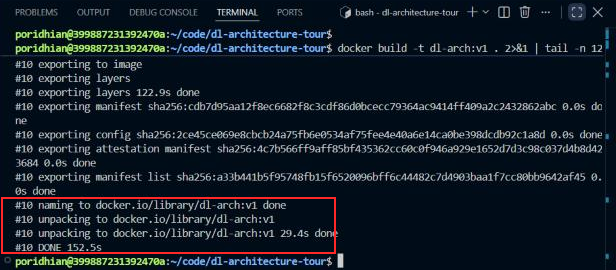

The boxed lines show the image tagged `dl-arch:v1` and the build finishing in about 150 seconds. Most of that time is spent downloading PyTorch. Later builds reuse the cached dependency layer and only copy `src/`.

Then check the project files and the image:

```bash
find . -type f -not -path './outputs/*' | sort && docker images dl-arch
```

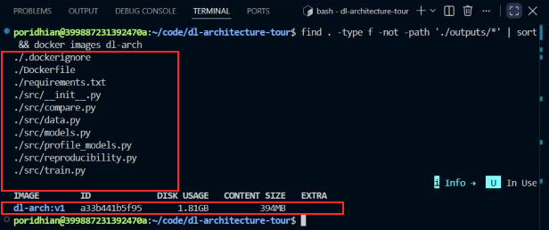

The first box lists every file from Section 3 (Project Structure), so nothing is missing from the build context. The second box shows `dl-arch:v1` at 1.81 GB on disk, which is mostly Python and PyTorch.

### Step 8 — Train the Three Models

**Objective:** train the CNN, LSTM and Transformer with the same seed and settings, and save each model's accuracy, training time and weights to `outputs/`.

All commands mount `outputs/` and run as your user:

```bash
docker run --rm --user "$(id -u):$(id -g)" -v "$(pwd)/outputs:/app/outputs" dl-arch:v1 python -m src.train --model cnn
docker run --rm --user "$(id -u):$(id -g)" -v "$(pwd)/outputs:/app/outputs" dl-arch:v1 python -m src.train --model lstm
docker run --rm --user "$(id -u):$(id -g)" -v "$(pwd)/outputs:/app/outputs" dl-arch:v1 python -m src.train --model transformer
```

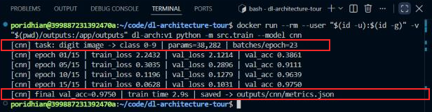

The top box shows the task and the size: 38,282 parameters and 23 batches per epoch. The bottom box shows the result: 97.50% validation accuracy in 2.9 seconds. Convolutions reuse the same small filters across the image, so the CNN learns quickly from very little data.

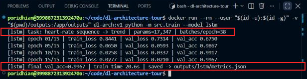

The LSTM is the smallest model (17,347 parameters), yet it took 20.6 seconds, about 7× longer than the CNN. It must process the 48 time steps **one after another**, so the steps cannot run in parallel. It still reaches 99.67% accuracy, because a trend over time is exactly what recurrent memory is built for.

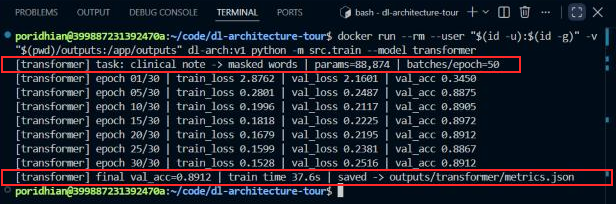

The Transformer has 88,874 parameters; 16,384 of them are position embeddings for up to 256 tokens. Masked-word accuracy rises from 34.5% to about 89% and then levels off. Some masked words, such as the subject or the duration, are chosen at random in the notes, so no model can predict them reliably. The symptom → plan words are learned.

### Step 9 — Profile Parameters and FLOPs

**Objective:** measure each model's size (parameters) and compute cost (FLOPs per sample), and show how LSTM and Transformer cost grow as the sequence gets longer.

```bash
docker run --rm --user "$(id -u):$(id -g)" -v "$(pwd)/outputs:/app/outputs" dl-arch:v1 python -m src.profile_models
```

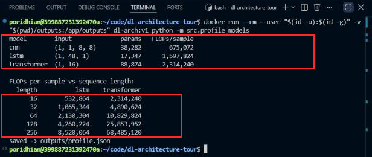

The top box gives the compute for one sample. The CNN needs the fewest FLOPs (675k). The LSTM needs 2.4× more than the CNN with half as many parameters, because it reuses the same weights at all 48 steps. The bottom box is the key result: going from length 16 to 256 (16×), the LSTM's FLOPs grow **16.0×** (linear; only the small fixed output layer breaks exact doubling), while the Transformer's grow **29.6×**. The `(L × L)` attention scores make its cost grow faster than linearly.

### Step 10 — Compare Everything

**Objective:** combine accuracy, training time, parameters and FLOPs into one view, and decide which architecture fits each ShasthyoLens feature.

```bash
docker run --rm --user "$(id -u):$(id -g)" -v "$(pwd)/outputs:/app/outputs" dl-arch:v1 python -m src.compare
```

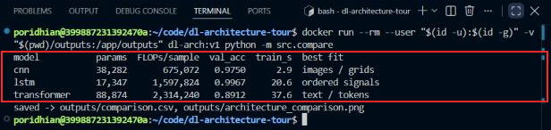

The boxed table joins the training metrics with the profile. Each family wins on its own data type: the CNN on images (cheapest), the LSTM on ordered signals (most accurate), and the Transformer on text (the only one that models whole sentences at once). The table is also saved as `outputs/comparison.csv`.

---

## 7. Verification and Testing

```bash
ls -l outputs/*/ outputs/*.*
```

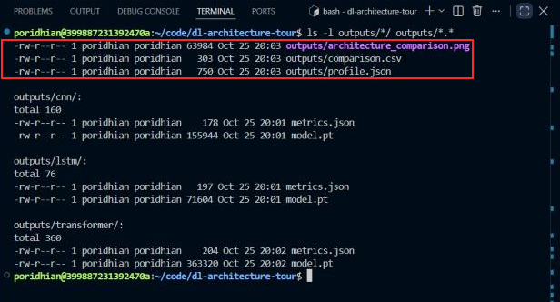

The box marks the three analysis files: the chart, `comparison.csv` and `profile.json`. Each model folder holds `metrics.json` and `model.pt`. Because they are on the host, they remain after every container has exited.

| Check | Success means |
|---|---|
| Training runs | Each prints `final val_acc=…` and `saved -> outputs/<model>/metrics.json` |
| Parameter counts | CNN 38,282 · LSTM 17,347 · Transformer 88,874 (these are fixed by the architecture, so they match on every machine) |
| FLOPs | Profile prints non-zero FLOPs for all three models, and LSTM FLOPs about double each time the length doubles (linear growth) |
| Outputs | `comparison.csv`, `profile.json` and `architecture_comparison.png` exist |

Parameter counts and FLOPs are the same on any machine. Accuracy can vary in the last digits on other CPUs, and training time depends on the hardware.

---

## 8. Results and Observations

Open `outputs/architecture_comparison.png` from the Explorer:

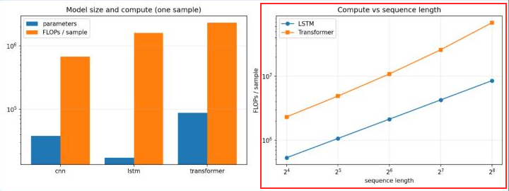

The red box marks the key result. On log–log axes the LSTM line rises with slope 1 (linear cost), while the Transformer line climbs more steeply as the sequence gets longer, so the gap widens from about 4× at 16 tokens to about 8× at 256 tokens.

| Architecture | Task | Params | FLOPs / sample | Val accuracy | Train time | Best fit |
|---|---|---|---|---|---|---|
| CNN | digit image → class 0–9 | 38,282 | 675,072 | 0.9750 | 2.9 s | images / grids |
| LSTM | heart-rate sequence → trend | 17,347 | 1,597,824 | 0.9967 | 20.6 s | ordered signals |
| Transformer | clinical note → masked words | 88,874 | 2,314,240 | 0.8912* | 37.6 s | text / tokens |

\* Masked-word accuracy: a different metric from classification accuracy, so it is not directly comparable.

| Sequence length | 16 | 32 | 64 | 128 | 256 |
|---|---|---|---|---|---|
| LSTM FLOPs | 532,864 | 1,065,344 | 2,130,304 | 4,260,224 | 8,520,064 |
| Transformer FLOPs | 2,314,240 | 4,890,624 | 10,829,824 | 25,853,952 | 68,485,120 |

**Observations**

- **Parameters ≠ compute.** The LSTM has the fewest parameters but more FLOPs than the CNN, because its weights are reused at every time step.
- **Sequential vs parallel.** The LSTM's FLOPs are linear in length, but its steps must run one after another, so it trains slowly. The Transformer processes all tokens at once.
- **Attention cost grows faster.** From length 128 → 256, Transformer FLOPs grow 2.65× versus the LSTM's 2.0×. At long lengths, the `L²` attention term dominates.
- **For ShasthyoLens:** use a CNN for form digits, an LSTM (or a 1-D CNN) for short vital-sign streams, and a Transformer for clinical text, keeping notes short to control cost.

---

## 9. Troubleshooting

**Terminal won't open / Restricted Mode**
- **Cause:** the workspace is not trusted.
- **Fix:** click **Trust Folder & Continue**.

**`permission denied ... docker.sock`**
- **Cause:** your user is not in the `docker` group.
- **Fix:** use `sudo docker …`, or run `sudo usermod -aG docker $USER` and open a new terminal.

**`No matching distribution found for torch==2.3.1+cpu`**
- **Cause:** the `--extra-index-url` line is missing.
- **Fix:** restore the first line of `requirements.txt` and rebuild.

**`FileNotFoundError: outputs/profile.json` or `.../metrics.json` in compare**
- **Cause:** `compare.py` ran before training or profiling.
- **Fix:** run Steps 8 and 9 first, from the project root, with the same `-v` mount.

**`PermissionError` writing to `outputs/`**
- **Cause:** an earlier container ran as root.
- **Fix:** run `sudo chown -R $(id -u):$(id -g) outputs`, then rerun with `--user`.

**Profile shows 0 FLOPs for a model**
- **Cause:** a fused or unsupported operator. For example, `nn.LSTM` can use a fused kernel that the counter does not see.
- **Fix:** keep the explicit `LSTMCell` loop and the hand-written attention from `models.py`.

---

## 10. Conclusion

ShasthyoLens needed evidence to match three product features to three network families. In this lab you built a CNN, an LSTM and a Transformer in one pinned Docker image, trained them on offline image, sequence and text data, and measured their size and compute. The CNN reached 97.5% at the lowest cost (675k FLOPs), the LSTM reached 99.7% on heart-rate trends but trained slowest because of its sequential steps, and the Transformer learned masked clinical words at 89%. The profile showed that LSTM compute grows linearly with sequence length while Transformer compute grew 29.6× for a 16× longer input. These numbers let a team choose an architecture by data type and budget, rather than by fashion.
