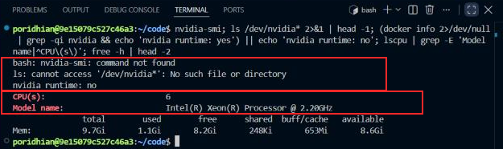
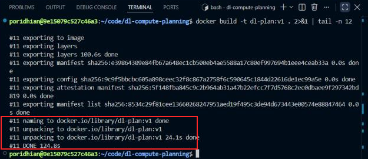
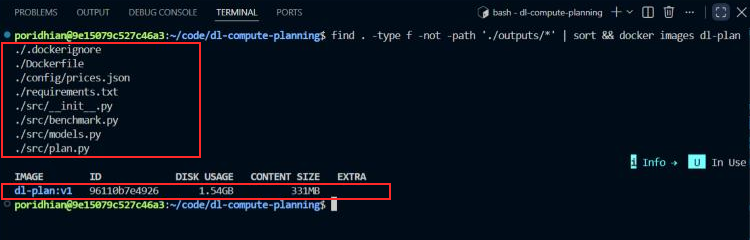
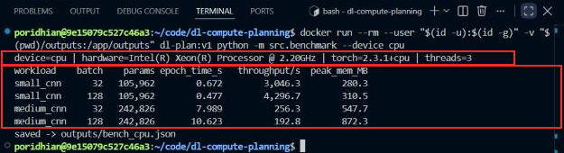
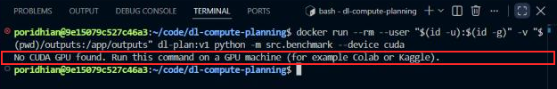
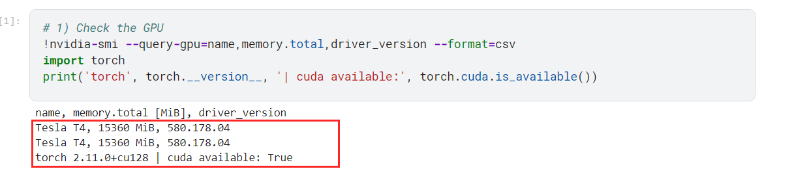
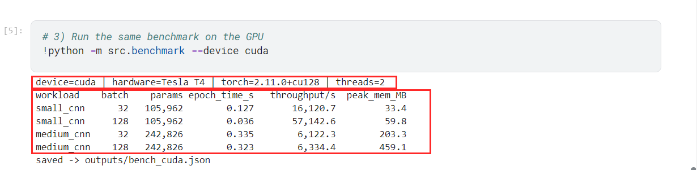
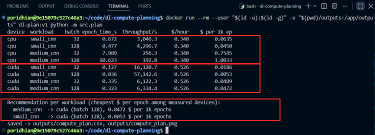
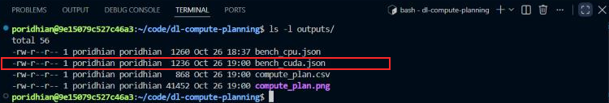
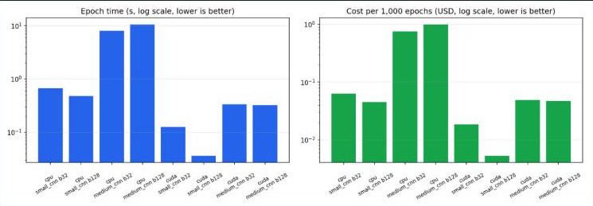

# CPU vs GPU vs TPU Compute Planning

**Level:** Beginner · **Stack:** Docker, Python 3.11.9, PyTorch 2.3.1

---

## 1. Introduction

**ShasthyoLens** is about to move model training to the cloud. Before it rents any machine, the finance lead asks: *"For each of our models, which hardware gives the lowest cost per epoch, and how much faster is the expensive one really?"* Guessing "GPU is always better" can waste money. A small model may run almost as fast on a cheaper CPU.

You will benchmark the **same training step** on different hardware, record **epoch time**, **throughput** and **peak memory**, convert time into **dollars per epoch** using real cloud prices, and build a **compute-planning matrix** with a recommendation for each workload.


The project files are built into one pinned image, `dl-plan:v1`. On the Poridhi VM (CPU only), `benchmark.py --device cpu` times two CNN workloads (small and medium) at two batch sizes, with warm-up steps and the median of 3 epochs. It writes `bench_cpu.json` to the mounted `outputs/` folder. The **same code** runs with `--device cuda` on any machine with an NVIDIA GPU (Colab, Kaggle or a GPU lab) and produces `bench_cuda.json`. TPU is optional and is compared by price only. Finally, `plan.py` joins the benchmark files with `config/prices.json` and writes the planning matrix and a chart.

**Key terms**

| Term | Meaning | Formula |
|---|---|---|
| **Epoch time** | Time to train on the whole dataset once | measured (median of 3) |
| **Throughput** | Samples processed per second | $\text{samples} / \text{epoch time}$ |
| **Cost per epoch** | Cloud cost of one epoch | $\text{USD per hour} \times \text{epoch time (s)} / 3600$ |
| **Break-even speed-up** | How much faster a pricier device must be to cost less per epoch | $\text{price}_{\text{fast}} / \text{price}_{\text{slow}}$ |

---

## 2. Objectives

By the end of this lab, you will be able to:

- Explain how CPUs, GPUs and TPUs differ for deep learning work.
- Benchmark a training step fairly: same model, data and batch size, with warm-up, repeats and GPU synchronisation.
- Measure epoch time, throughput and peak memory.
- Convert epoch time into dollars per epoch using real cloud prices.
- Build a compute-planning matrix and recommend hardware per workload.

---

## 3. Project Structure

```text
dl-compute-planning/
├── Dockerfile
├── .dockerignore
├── requirements.txt
├── config/
│   └── prices.json        # cloud prices used for cost per epoch
├── src/
│   ├── __init__.py
│   ├── models.py          # small_cnn and medium_cnn workloads
│   ├── benchmark.py       # times a training step on one device
│   └── plan.py            # builds the planning matrix + chart
├── kaggle/
│   └── gpu_benchmark.ipynb  # same benchmark, ready to run on a Kaggle GPU
├── outputs/               # bench_<device>.json, compute_plan.* (mounted volume)
└── docs/images/
```

---

## 4. Prerequisites

| Requirement | Purpose / Version |
|---|---|
| VS Code Server (Poridhi) | Editor + integrated terminal; runs the CPU benchmark |
| Docker Engine | Builds and runs the pinned image |
| A machine with an NVIDIA GPU | **Needed for the GPU column.** This lab used Kaggle (free Tesla T4); Colab or a GPU-enabled lab also work |
| Internet access | Pull the base image and the pip packages |

**Cloud prices used** (`config/prices.json`, on-demand, checked 2026-10-27):

| Device | Instance | USD / hour |
|---|---|---|
| CPU | AWS c6i.2xlarge (8 vCPU, 16 GiB), us-east-1 | 0.34 |
| GPU | AWS g4dn.xlarge (1× NVIDIA T4 16 GB), us-east-1 | 0.526 |
| TPU | Google Cloud TPU v5e (1 chip), us-central1 | 1.20 |

Prices change over time, so update `prices.json` before planning a real budget.

---

## 5. Environment Setup

1. Open the terminal (**Terminal → New Terminal**). If VS Code shows *Restricted Mode*, click **Trust Folder & Continue**.
2. Check what hardware this machine has:

```bash
nvidia-smi; ls /dev/nvidia* 2>&1 | head -1; (docker info 2>/dev/null | grep -qi nvidia && echo 'nvidia runtime: yes') || echo 'nvidia runtime: no'; lscpu | grep -E 'Model name|^CPU\(s\)'; free -h | head -2
```



The first box shows that this Poridhi VM has **no GPU**: `nvidia-smi` does not exist, there is no `/dev/nvidia*` device, and Docker has no NVIDIA runtime. The second box shows what it does have: 6 vCPUs of an Intel Xeon at 2.20 GHz and 9.7 GB RAM. So the CPU column is measured here, and the GPU column needs a GPU machine (Step 8).

3. Create the project:

```bash
mkdir -p ~/code/dl-compute-planning/{src,config,outputs,docs/images}
cd ~/code/dl-compute-planning
```

Create each file below with **Explorer → New File**. `src/__init__.py` stays empty.

---

## 6. Project Implementation

### Step 1 — Pin the Environment

**Objective:** use the same Python and PyTorch versions for every CPU run, so the measurements are comparable.

**`requirements.txt`**

```text
--extra-index-url https://download.pytorch.org/whl/cpu
torch==2.3.1+cpu
numpy==1.26.4
matplotlib==3.9.0
```

**`Dockerfile`**

```dockerfile
FROM python:3.11.9-slim-bookworm

# No OMP_NUM_THREADS limit here: the CPU benchmark should use every core the machine has
ENV PYTHONDONTWRITEBYTECODE=1 \
    PYTHONUNBUFFERED=1 \
    MPLCONFIGDIR=/tmp/matplotlib

WORKDIR /app
COPY requirements.txt .
RUN pip install --no-cache-dir -r requirements.txt
COPY config/ ./config/
COPY src/ ./src/

CMD ["python", "-m", "src.benchmark", "--help"]
```

Unlike the previous labs, there is **no** `OMP_NUM_THREADS=1` here. A CPU benchmark should use the cores the machine actually has.

**`.dockerignore`**

```text
outputs/
docs/
**/__pycache__/
*.md
```

### Step 2 — Record Cloud Prices

**Objective:** store the hourly prices in one file, so cost per epoch is calculated the same way for every device.

**`config/prices.json`**

```json
{
  "checked_on": "2026-10-27",
  "note": "On-demand list prices, USD per hour, used only to estimate cost per epoch.",
  "cpu": {"instance": "AWS c6i.2xlarge (8 vCPU, 16 GiB), us-east-1", "usd_per_hour": 0.34, "source": "https://www.doit.com/compute/spot/us-east-1/c6i.2xlarge"},
  "cuda": {"instance": "AWS g4dn.xlarge (1x NVIDIA T4 16 GB), us-east-1", "usd_per_hour": 0.526, "source": "https://calculator.holori.com/aws/ec2/g4dn.xlarge/us-east-1"},
  "tpu": {"instance": "Google Cloud TPU v5e (1 chip), us-central1", "usd_per_hour": 1.20, "source": "https://cloud.google.com/tpu/pricing"}
}
```

### Step 3 — Define the Workloads

**Objective:** use a light and a heavy workload, because the best hardware depends on how much work each step does.

- **small_cnn:** 1×28×28 images (MNIST-sized), 105,962 parameters.
- **medium_cnn:** 3×64×64 colour images, 242,826 parameters. It has only about 2.3× the parameters, but each image has about 16× more pixel values and the conv layers are wider, so it does far more computation per sample.

**`src/models.py`**

```python
"""Two CNN workloads of very different size, so the hardware comparison has both a light and a heavy case."""
import torch.nn as nn


def conv_block(c_in, c_out):
    return nn.Sequential(nn.Conv2d(c_in, c_out, 3, padding=1), nn.BatchNorm2d(c_out), nn.ReLU(), nn.MaxPool2d(2))


class SmallCNN(nn.Module):
    """Light workload: 1x28x28 images (MNIST-sized), about 0.1 M parameters."""

    def __init__(self, num_classes=10):
        super().__init__()
        self.net = nn.Sequential(conv_block(1, 16), conv_block(16, 32), nn.Flatten(),
                                 nn.Linear(32 * 7 * 7, 64), nn.ReLU(), nn.Linear(64, num_classes))

    def forward(self, x):
        return self.net(x)


class MediumCNN(nn.Module):
    """Heavy workload: 3x64x64 colour images, four conv blocks, about 0.24 M parameters but far more FLOPs."""

    def __init__(self, num_classes=10):
        super().__init__()
        self.net = nn.Sequential(conv_block(3, 32), conv_block(32, 64), conv_block(64, 128), conv_block(128, 128),
                                 nn.AdaptiveAvgPool2d(1), nn.Flatten(), nn.Linear(128, num_classes))

    def forward(self, x):
        return self.net(x)


WORKLOADS = {  # name: (model class, input shape of one sample)
    "small_cnn": (SmallCNN, (1, 28, 28)),
    "medium_cnn": (MediumCNN, (3, 64, 64)),
}


def count_parameters(model):
    return sum(p.numel() for p in model.parameters())
```

### Step 4 — The Benchmark Script

**Objective:** time **the same training step** fairly on any device.

Fair-benchmark rules used in the code:

| Rule | Why |
|---|---|
| Same model, batch size and number of samples (2,048 per epoch) | Only the hardware changes |
| Synthetic data created directly on the device | Measures compute, not disk or data loading |
| 5 warm-up steps before timing | The first steps are slow (memory allocation, kernel selection) |
| `torch.cuda.synchronize()` before reading the clock | GPU calls are asynchronous; without it the GPU looks falsely fast |
| 3 timed epochs, median reported | Removes noise from other processes |

**`src/benchmark.py`**

```python
"""Time the same training step on one device and save epoch time, throughput and peak memory.

  python -m src.benchmark --device cpu
  python -m src.benchmark --device cuda     # on a machine with an NVIDIA GPU
"""
import argparse
import json
import platform
import resource
import statistics
import time
from pathlib import Path

import torch
import torch.nn as nn

from src.models import WORKLOADS, count_parameters

BATCH_SIZES = [32, 128]
EPOCH_SAMPLES = 2048  # one "epoch" = 2,048 synthetic samples
WARMUP_STEPS = 5
REPEATS = 3


def sync(device):
    if device.type == "cuda":
        torch.cuda.synchronize()  # GPU calls are asynchronous: wait before reading the clock


def device_name(device):
    if device.type == "cuda":
        return torch.cuda.get_device_name(0)
    for line in Path("/proc/cpuinfo").read_text().splitlines():
        if line.startswith("model name"):
            return line.split(":", 1)[1].strip()
    return platform.processor() or "cpu"


def run_epoch(model, optimizer, criterion, x, y, batch_size):
    for i in range(0, len(x), batch_size):
        optimizer.zero_grad(set_to_none=True)
        loss = criterion(model(x[i:i + batch_size]), y[i:i + batch_size])
        loss.backward()
        optimizer.step()


def benchmark(name, batch_size, device):
    model_cls, shape = WORKLOADS[name]
    torch.manual_seed(42)
    model = model_cls().to(device)
    optimizer = torch.optim.SGD(model.parameters(), lr=0.01, momentum=0.9)
    criterion = nn.CrossEntropyLoss()
    # synthetic data created directly on the device, so we time compute only (no disk / data loading)
    x = torch.randn(EPOCH_SAMPLES, *shape, device=device)
    y = torch.randint(0, 10, (EPOCH_SAMPLES,), device=device)

    if device.type == "cuda":
        torch.cuda.reset_peak_memory_stats()
    for _ in range(WARMUP_STEPS):  # first steps are slow (kernel selection, memory allocation)
        run_epoch(model, optimizer, criterion, x[:batch_size], y[:batch_size], batch_size)
    sync(device)

    times = []
    for _ in range(REPEATS):
        start = time.perf_counter()
        run_epoch(model, optimizer, criterion, x, y, batch_size)
        sync(device)
        times.append(time.perf_counter() - start)

    epoch_time = statistics.median(times)
    if device.type == "cuda":
        peak_mb = torch.cuda.max_memory_allocated() / 2**20
    else:
        peak_mb = resource.getrusage(resource.RUSAGE_SELF).ru_maxrss / 1024  # Linux reports KB
    return {"workload": name, "batch_size": batch_size, "params": count_parameters(model),
            "epoch_time_s": round(epoch_time, 3), "throughput_sps": round(EPOCH_SAMPLES / epoch_time, 1),
            "peak_memory_mb": round(peak_mb, 1), "repeat_times_s": [round(t, 3) for t in times]}


def main():
    p = argparse.ArgumentParser(description="Benchmark a training step on one device")
    p.add_argument("--device", choices=["cpu", "cuda"], default="cpu")
    p.add_argument("--output-dir", default="outputs")
    args = p.parse_args()
    if args.device == "cuda" and not torch.cuda.is_available():
        raise SystemExit("No CUDA GPU found. Run this command on a GPU machine (for example Colab or Kaggle).")

    device = torch.device(args.device)
    info = {"device": args.device, "hardware": device_name(device), "torch": torch.__version__,
            "cpu_threads": torch.get_num_threads(), "epoch_samples": EPOCH_SAMPLES, "repeats": REPEATS}
    print("device={} | hardware={} | torch={} | threads={}".format(
        args.device, info["hardware"], info["torch"], info["cpu_threads"]))
    print("{:<11} {:>5} {:>9} {:>12} {:>14} {:>12}".format(
        "workload", "batch", "params", "epoch_time_s", "throughput/s", "peak_mem_MB"))

    results = []
    for name in WORKLOADS:
        for bs in BATCH_SIZES:
            r = benchmark(name, bs, device)
            results.append(r)
            print("{:<11} {:>5} {:>9,} {:>12.3f} {:>14,.1f} {:>12.1f}".format(
                name, bs, r["params"], r["epoch_time_s"], r["throughput_sps"], r["peak_memory_mb"]))

    out = Path(args.output_dir)
    out.mkdir(parents=True, exist_ok=True)
    path = out / "bench_{}.json".format(args.device)
    path.write_text(json.dumps({"info": info, "results": results}, indent=2))
    print("saved -> {}".format(path))


if __name__ == "__main__":
    main()
```

### Step 5 — The Planning Script

**Objective:** turn benchmark files and prices into a compute-planning matrix.

`plan.py` reads **every** `outputs/bench_<device>.json` it finds. When you add `bench_cuda.json` later, the GPU column appears automatically.

**`src/plan.py`**

```python
"""Turn benchmark files + hourly prices into a compute-planning matrix.

  python -m src.plan
Reads every outputs/bench_<device>.json that exists, so GPU results can be added later.
"""
import csv
import json
from pathlib import Path

import matplotlib

matplotlib.use("Agg")
import matplotlib.pyplot as plt  # noqa: E402


def main():
    out = Path("outputs")
    prices = json.loads(Path("config/prices.json").read_text())
    rows = []
    for path in sorted(out.glob("bench_*.json")):
        bench = json.loads(path.read_text())
        dev = bench["info"]["device"]
        price = prices[dev]["usd_per_hour"]
        for r in bench["results"]:
            cost = price * r["epoch_time_s"] / 3600
            rows.append({"device": dev, "hardware": bench["info"]["hardware"], "workload": r["workload"],
                         "batch_size": r["batch_size"], "epoch_time_s": r["epoch_time_s"],
                         "throughput_sps": r["throughput_sps"], "peak_memory_mb": r["peak_memory_mb"],
                         "usd_per_hour": price, "usd_per_epoch": cost, "usd_per_1k_epochs": round(cost * 1000, 4)})
    if not rows:
        raise SystemExit("No outputs/bench_*.json found. Run src.benchmark first.")

    with open(out / "compute_plan.csv", "w", newline="") as f:
        writer = csv.DictWriter(f, fieldnames=list(rows[0]))
        writer.writeheader()
        writer.writerows(rows)

    line = "{:<7} {:<11} {:>5} {:>12} {:>13} {:>10} {:>14}"
    print(line.format("device", "workload", "batch", "epoch_time_s", "throughput/s", "$/hour", "$ per 1k ep"))
    for r in rows:
        print(line.format(r["device"], r["workload"], r["batch_size"], "{:.3f}".format(r["epoch_time_s"]),
                          "{:,.1f}".format(r["throughput_sps"]), "{:.3f}".format(r["usd_per_hour"]),
                          "{:.4f}".format(r["usd_per_1k_epochs"])))

    print()
    print("Recommendation per workload (cheapest $ per epoch among measured devices):")
    for wl in sorted({r["workload"] for r in rows}):
        best = min((r for r in rows if r["workload"] == wl), key=lambda r: r["usd_per_epoch"])
        print("  {:<11} -> {} (batch {}), {:.4f} $ per 1k epochs".format(
            wl, best["device"], best["batch_size"], best["usd_per_1k_epochs"]))

    labels = ["{}\n{} b{}".format(r["device"], r["workload"], r["batch_size"]) for r in rows]
    fig, (ax1, ax2) = plt.subplots(1, 2, figsize=(13, 4.5))
    ax1.bar(labels, [r["epoch_time_s"] for r in rows], color="#2563eb")
    ax1.set_title("Epoch time (s, log scale, lower is better)")
    ax2.bar(labels, [r["usd_per_1k_epochs"] for r in rows], color="#16a34a")
    ax2.set_title("Cost per 1,000 epochs (USD, log scale, lower is better)")
    for ax in (ax1, ax2):
        ax.set_yscale("log")
        ax.tick_params(axis="x", labelsize=8, labelrotation=30)
        ax.grid(axis="y", alpha=0.3)
    fig.tight_layout()
    fig.savefig(out / "compute_plan.png", dpi=150)
    print("saved -> outputs/compute_plan.csv, outputs/compute_plan.png")


if __name__ == "__main__":
    main()
```

### Step 6 — Build the Image

**Objective:** package the benchmark with pinned libraries.

```bash
docker build -t dl-plan:v1 . 2>&1 | tail -n 12
```



The boxed lines show the image tagged `dl-plan:v1` and the build finishing in about 125 seconds. Most of that time is spent downloading PyTorch.

```bash
find . -type f -not -path './outputs/*' | sort && docker images dl-plan
```



The first box lists all eight project files, including `config/prices.json`. The second box shows the image `dl-plan:v1` at 1.54 GB on disk.

### Step 7 — Benchmark on CPU

**Objective:** measure epoch time, throughput and peak memory for both workloads on the CPU.

```bash
docker run --rm --user "$(id -u):$(id -g)" -v "$(pwd)/outputs:/app/outputs" dl-plan:v1 python -m src.benchmark --device cpu
```



The top box records the conditions: Intel Xeon @ 2.20 GHz, torch 2.3.1+cpu, and **3 threads**, the number PyTorch picked by default on this 6-vCPU VM. Keep it the same across runs. The bottom box shows the key results. The small CNN runs an epoch in under 1 second. The medium CNN takes 8–11 seconds, about 17× longer than the small CNN's best epoch. For the medium CNN, the larger batch (128) is **slower** than batch 32 on this CPU (192.8 vs 256.3 samples/s). The likely reason is that its larger activations no longer fit in the CPU cache.

### Step 8 — Benchmark on GPU

**Objective:** run the exact same benchmark on an NVIDIA GPU, to fill the GPU column.

First, try it on Poridhi:

```bash
docker run --rm --user "$(id -u):$(id -g)" -v "$(pwd)/outputs:/app/outputs" dl-plan:v1 python -m src.benchmark --device cuda
```



The boxed line shows the script stopping safely with a clear message, because this VM has no CUDA GPU. Without this check, PyTorch would crash with a long CUDA error. The script also tells you where to run it instead.

**Run it on a Kaggle GPU (free Tesla T4).** The notebook `kaggle/gpu_benchmark.ipynb` contains the same `models.py` and `benchmark.py` (written with `%%writefile`), so no upload of the project is needed.

1. Sign in to Kaggle and verify your phone number (**Settings → Phone verification**). This is required for GPU access.
2. **Create → New Notebook → File → Import Notebook**, then select `kaggle/gpu_benchmark.ipynb`.
3. In the right panel, set **Session options → Accelerator → GPU T4 x2**. The script uses one GPU.
4. Click **Run All**.



The boxed output confirms the hardware before benchmarking: a **Tesla T4** with 15,360 MiB of memory (Kaggle attaches two; the script uses the first), and PyTorch 2.11.0 built for CUDA 12.8 with `cuda available: True`. This T4 is the same GPU model as in the AWS g4dn.xlarge price in `prices.json`, so the cost comparison matches the hardware.



The top box records the conditions (`device=cuda`, Tesla T4, torch 2.11.0+cu128). The bottom box shows the same four workload/batch rows as on CPU. The medium CNN now takes about **0.33 s** per epoch instead of 8–11 s. The small CNN at batch 128 processes **57,143 samples/s**. Peak memory here is GPU memory (`max_memory_allocated`), reset for each workload.

5. Download `/kaggle/working/outputs/bench_cuda.json` from the notebook's Output panel. Drag it into `outputs/` in the Poridhi Explorer, then run Step 9.

> Kaggle uses its own PyTorch build (2.11.0+cu128), not the pinned 2.3.1+cpu. The version is recorded in `bench_cuda.json` (`"torch"`), so the comparison stays transparent.

### Step 9 — Build the Compute-Planning Matrix

**Objective:** convert time into money and pick the cheapest hardware per workload.

```bash
docker run --rm --user "$(id -u):$(id -g)" -v "$(pwd)/outputs:/app/outputs" dl-plan:v1 python -m src.plan
```



The first box holds the four CPU rows ($0.34/h) and the second box the four GPU rows ($0.526/h), all from measured epoch times. The GPU row is cheaper per epoch in **every** case, even though its hourly price is 1.55× higher. The third box is the recommendation: **GPU at batch 128 for both workloads**, at **$0.0472** per 1,000 epochs for the medium CNN (CPU best: $0.7545) and **$0.0053** for the small CNN (CPU best: $0.0450).

---

## 7. Verification and Testing

```bash
ls -l outputs/
```



The box marks `bench_cuda.json`, the GPU result copied in from Kaggle, next to `bench_cpu.json`. `compute_plan.csv` and `compute_plan.png` were regenerated from both files at 19:00, after the GPU file was added.

| Check | Success means |
|---|---|
| Hardware check | You know which devices the machine really has before benchmarking |
| CPU benchmark | 4 rows (2 workloads × 2 batch sizes) and `saved -> outputs/bench_cpu.json` |
| GPU guard | `--device cuda` on a CPU-only machine prints a clear message instead of a crash |
| GPU benchmark | Kaggle prints `device=cuda`, `Tesla T4`, 4 rows, and `saved -> outputs/bench_cuda.json` |
| Plan | `compute_plan.csv` and `.png` exist, and the cost column equals price × time / 3600 |
| Fairness | Every device runs the same workloads, batch sizes and number of samples |

Epoch times depend on the CPU or GPU model and on other load on the machine. The repeat times in each `bench_*.json` show how stable each measurement was. All GPU repeats were within 0.01 s of each other.

---

## 8. Results and Observations



Both panels use a log scale, because the GPU bars are 5–33× shorter than the CPU bars. The cost panel (right) has almost the same shape as the time panel (left). The GPU's 1.55× higher hourly price only shifts its bars up slightly, which is far less than the speed-up it brings down.

**Measured results** (CPU: Poridhi, Intel Xeon @ 2.20 GHz, 3 threads · GPU: Kaggle, Tesla T4)

| Workload | Batch | CPU epoch | GPU epoch | GPU speed-up | CPU $ / 1k ep | GPU $ / 1k ep | Cheaper |
|---|---|---|---|---|---|---|---|
| small_cnn | 32 | 0.672 s | 0.127 s | 5.3× | 0.0635 | 0.0186 | GPU |
| small_cnn | 128 | 0.477 s | 0.036 s | 13.3× | 0.0450 | 0.0053 | GPU |
| medium_cnn | 32 | 7.989 s | 0.335 s | 23.8× | 0.7545 | 0.0489 | GPU |
| medium_cnn | 128 | 10.623 s | 0.323 s | 32.9× | 1.0033 | 0.0472 | GPU |

| Workload | Batch | CPU throughput | GPU throughput | CPU peak RAM* | GPU peak memory |
|---|---|---|---|---|---|
| small_cnn | 32 | 3,046 /s | 16,121 /s | 280 MB | 33 MB |
| small_cnn | 128 | 4,297 /s | 57,143 /s | 311 MB | 60 MB |
| medium_cnn | 32 | 256 /s | 6,122 /s | 548 MB | 203 MB |
| medium_cnn | 128 | 193 /s | 6,334 /s | 872 MB | 459 MB |

\* CPU peak RAM is the whole process's maximum so far (it includes Python and earlier rows). GPU peak memory is only the tensors on the GPU and is reset for each workload, so the two columns are not directly comparable.

**Break-even speed-ups** (from `prices.json`): a T4 costs $0.526 / $0.34 = **1.55×** the CPU price, so it is cheaper whenever it is at least 1.55× faster. Every measured speed-up (5.3× to 32.9×) is far above that. A TPU v5e chip costs **3.53×** the CPU price, so it would need to be at least 3.53× faster than the CPU. It was not measured in this lab.

**Observations**

- **The heavier the workload, the bigger the GPU win.** The medium CNN gained 24–33×, the small CNN 5–13×. More convolution work per step keeps more of the GPU's parallel cores busy.
- **Small batches under-use the GPU.** For the small CNN, batch 128 is 3.5× faster than batch 32 on the GPU (57,143 vs 16,121 samples/s). With tiny batches, the time to launch each operation dominates. The medium CNN is already near the T4's limit at batch 32, so batch 128 adds only 3%.
- **Batch size behaves differently on each device.** Batch 128 made the medium CNN 25% slower on CPU (likely a cache effect) but slightly faster on GPU. Tune batch size per device, not once for all.
- **Price per hour misleads; cost per epoch decides.** The GPU costs 1.55× more per hour but is 8.5× cheaper per epoch for the small CNN and 16× cheaper for the medium CNN (best batch on each device).
- **For ShasthyoLens:** train both models on a T4 GPU at batch 128. The CPU is only worth it when no GPU is available or when jobs are too small to fill a GPU.

---

## 9. Troubleshooting

**`nvidia-smi: command not found` / no `/dev/nvidia*`**
- **Cause:** the machine has no NVIDIA GPU, as on this Poridhi VM.
- **Fix:** run Step 8 on Colab, Kaggle or a GPU-enabled lab, and copy back `bench_cuda.json`.

**`No CUDA GPU found` from `benchmark.py`**
- **Cause:** `--device cuda` was used where PyTorch cannot see a GPU, or the CPU-only image (`+cpu` torch) was used on a GPU machine.
- **Fix:** on Kaggle or Colab, run the script directly with the notebook's PyTorch, not inside `dl-plan:v1`. For a GPU Docker run, use a CUDA base image and `--gpus all`.

**Kaggle shows `cuda available: False`**
- **Cause:** the accelerator is set to None, or the phone number is not verified.
- **Fix:** verify the phone in Settings, then set **Session options → Accelerator → GPU T4 x2** and restart the session.

**GPU looks impossibly fast**
- **Cause:** time was read before the GPU finished its work.
- **Fix:** keep `torch.cuda.synchronize()` before every clock read, as in `sync()`.

**Epoch times jump between runs**
- **Cause:** other processes are using the CPU.
- **Fix:** close heavy programs, compare the three values in `repeat_times_s`, and rerun if they differ by more than about 10%.

**`KeyError` in `plan.py`**
- **Cause:** a `bench_<device>.json` exists for a device that has no entry in `prices.json`.
- **Fix:** add that device and its hourly price to `config/prices.json`.

---

## 10. Conclusion

ShasthyoLens needed hard numbers before renting cloud hardware. In this lab you built a fair benchmark (same training step, warm-up, three timed repeats, GPU synchronisation), ran it on a Poridhi CPU and a Kaggle Tesla T4, and turned the timings into cost per epoch with real on-demand prices. The T4 was 5–33× faster than the CPU, well above its 1.55× break-even. So it was cheaper per epoch for every workload: $0.0472 vs $0.7545 per 1,000 epochs for the medium CNN, and $0.0053 vs $0.0450 for the small one. The benchmark also showed that the best batch size differs by device. A compute-planning matrix like this lets a team justify the hardware it rents with measured cost per epoch, not hourly price or habit.
