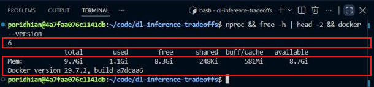
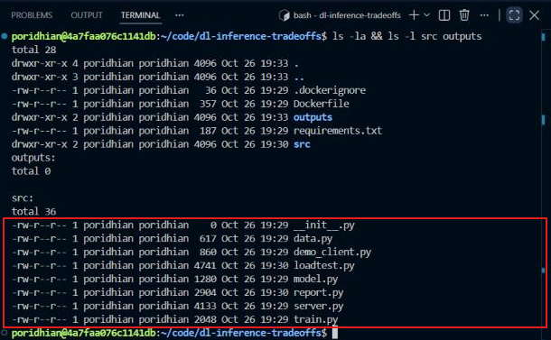
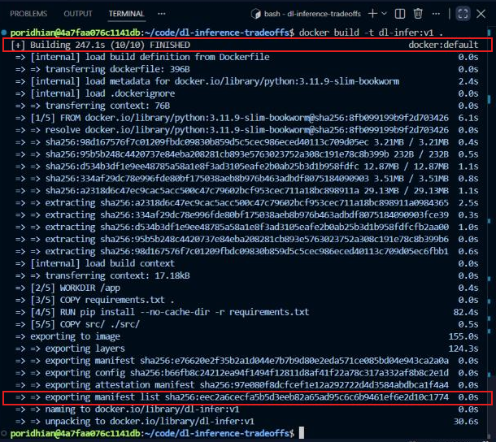
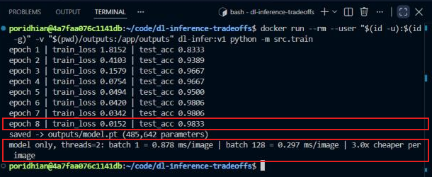
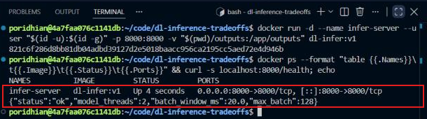
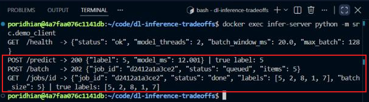
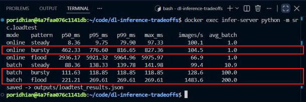
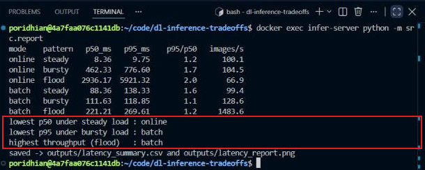
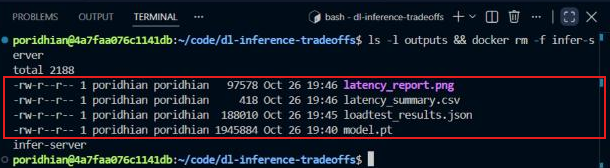
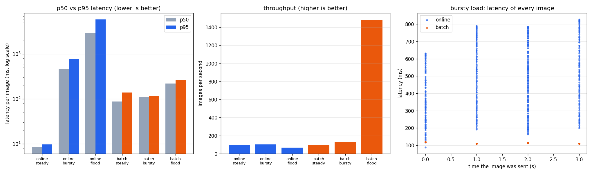

# Batch vs Online Inference Trade-offs


---

## 1. Introduction

**ShasthyoLens** has a trained digit-recognition model and must decide how to serve it. The mobile app needs a label in milliseconds. A nightly job sends thousands of scanned forms at once. Can one way of serving fit both?

You will serve the same model in two ways: a **synchronous online** `/predict` endpoint and an **asynchronous batch** `/batch` endpoint that returns a job ID. Then you send the same 400 images under **steady**, **bursty** and **flood** load and measure **p50 / p95 / p99 latency** and **throughput**.


A small CNN is trained once and saved as `model.pt`. A FastAPI server in the image `dl-infer:v1` loads it behind one lock, so only one forward pass runs at a time. `/predict` runs the model on one image and answers right away. `/batch` puts images in a queue and returns a `job_id`. A background worker groups waiting jobs and runs them through the model together. `loadtest.py` sends the same images to both endpoints, and `report.py` turns the latencies into a table and a chart.

**Key terms**

| Term | Meaning |
|---|---|
| **Online (synchronous) inference** | One request, one prediction, the client waits for the answer |
| **Batch (asynchronous) inference** | Many inputs per job, the server answers with a job ID and the result is fetched later |
| **Latency** | Time from an image's arrival at the client until its label is back |
| **p50 / p95 / p99** | 50%, 95% or 99% of images finished within this time. p95 and p99 are the **tail latency** |
| **Throughput** | Images labelled per second |
| **Steady / bursty load** | Requests arrive evenly vs. in sudden groups with the same average rate |

---

## 2. Objectives

By the end of this lab, you will be able to:

- Explain the difference between synchronous online and asynchronous batch inference.
- Serve one PyTorch model through a `/predict` endpoint and a `/batch` + `/jobs/{id}` endpoint with FastAPI.
- Generate steady, bursty and flood load and measure p50, p95 and p99 latency and throughput.
- Explain why tail latency grows under bursts and how batching changes it.
- Choose online or batch serving for a workload from measured numbers.

---

## 3. Project Structure

```text
dl-inference-tradeoffs/
├── Dockerfile
├── .dockerignore
├── requirements.txt
├── src/
│   ├── __init__.py
│   ├── data.py          # scikit-learn digits, train/test split
│   ├── model.py         # DigitCNN + load / predict helpers
│   ├── train.py         # trains once, saves outputs/model.pt
│   ├── server.py        # FastAPI: /predict, /batch, /jobs/{id}, /health
│   ├── demo_client.py   # calls every endpoint once
│   ├── loadtest.py      # steady / bursty / flood load, 6 scenarios
│   └── report.py        # summary table, CSV and chart
├── outputs/             # model.pt, loadtest_results.json, latency_* (mounted volume)
└── docs/images/
```

---

## 4. Prerequisites

| Requirement | Purpose / Version |
|---|---|
| VS Code Server (Poridhi) | Editor + integrated terminal |
| Docker Engine | Builds and runs the pinned image and the server container |
| Internet access | Pull the base image and the pip packages |
| Free port 8000 | The server listens on `localhost:8000` |

No GPU is needed. The model is small and every measurement runs on the CPU.

---

## 5. Environment Setup

1. Open the terminal (**Terminal → New Terminal**). If VS Code shows *Restricted Mode*, click **Trust Folder & Continue**.
2. Check the machine:

```bash
nproc && free -h | head -2 && docker --version
```



The first box shows 6 vCPUs. The second shows 9.7 GB of RAM and Docker 29.7.2. Latency numbers depend on this hardware, so record it with your results.

3. Create the project:

```bash
mkdir -p ~/code/dl-inference-tradeoffs/{src,outputs,docs/images}
cd ~/code/dl-inference-tradeoffs
```

Create each file below with **Explorer → New File**. `src/__init__.py` stays empty.

---

## 6. Project Implementation

### Step 1 — Pin the Environment

**Objective:** use fixed versions of Python, PyTorch and the web stack, so latency results can be compared between runs.

**`requirements.txt`**

```text
--extra-index-url https://download.pytorch.org/whl/cpu
torch==2.3.1+cpu
numpy==1.26.4
scikit-learn==1.5.0
matplotlib==3.9.0
fastapi==0.110.3
pydantic==2.7.1
uvicorn==0.29.0
httpx==0.27.0
```

**`Dockerfile`**

```dockerfile
FROM python:3.11.9-slim-bookworm

ENV PYTHONDONTWRITEBYTECODE=1 \
    PYTHONUNBUFFERED=1 \
    MPLCONFIGDIR=/tmp/matplotlib \
    MODEL_THREADS=2

WORKDIR /app
COPY requirements.txt .
RUN pip install --no-cache-dir -r requirements.txt
COPY src/ ./src/

EXPOSE 8000
CMD ["uvicorn", "src.server:app", "--host", "0.0.0.0", "--port", "8000", "--no-access-log"]
```

**`.dockerignore`**

```text
outputs/
docs/
**/__pycache__/
*.md
```

`MODEL_THREADS=2` gives the model 2 CPU threads, so the load generator has cores left. The default command starts the server with `uvicorn`. `--no-access-log` stops thousands of log lines from slowing the server during the load test.

### Step 2 — Data and Model

**Objective:** define the dataset and a CNN that is heavy enough for batching to matter.

**`src/data.py`**

```python
"""scikit-learn digits (1,797 images, 8x8, bundled offline) scaled to [0, 1]."""
import numpy as np
from sklearn.datasets import load_digits
from sklearn.model_selection import train_test_split

SEED = 42


def load_split():
    X, y = load_digits(return_X_y=True)
    X = (X / 16.0).astype(np.float32)
    return train_test_split(X, y, test_size=0.2, stratify=y, random_state=SEED)


def load_test_images(n):
    """Return n test images (repeating the test set if n is larger) and their true labels."""
    _, X_test, _, y_test = load_split()
    idx = np.arange(n) % len(X_test)
    return X_test[idx], y_test[idx]
```

**`src/model.py`**

```python
"""A small CNN for 8x8 handwritten digits, plus helpers to load it and run inference."""
import os
from pathlib import Path

import numpy as np
import torch
import torch.nn as nn

MODEL_PATH = Path("outputs/model.pt")


class DigitCNN(nn.Module):
    def __init__(self):
        super().__init__()
        self.features = nn.Sequential(
            nn.Conv2d(1, 64, 3, padding=1), nn.ReLU(),
            nn.Conv2d(64, 128, 3, padding=1), nn.ReLU(),
            nn.Conv2d(128, 128, 3, padding=1), nn.ReLU(),
            nn.MaxPool2d(2),  # 8x8 -> 4x4
        )
        self.head = nn.Sequential(nn.Flatten(), nn.Linear(128 * 4 * 4, 128), nn.ReLU(), nn.Linear(128, 10))

    def forward(self, x):
        return self.head(self.features(x))


def set_threads():
    torch.set_num_threads(int(os.environ.get("MODEL_THREADS", "2")))


def load_model(path=MODEL_PATH):
    set_threads()
    model = DigitCNN()
    model.load_state_dict(torch.load(path, map_location="cpu"))
    model.eval()
    return model


@torch.inference_mode()
def predict_labels(model, x):
    """x: float32 array of shape (n, 64) with values in [0, 1]. Returns n class labels."""
    t = torch.from_numpy(np.ascontiguousarray(x, dtype=np.float32)).reshape(-1, 1, 8, 8)
    return model(t).argmax(dim=1).numpy()
```

The model has three 3×3 convolution layers (64, 128, 128 channels) on 8×8 images. `predict_labels` runs under `torch.inference_mode()` and takes any number of images, so the **same function** serves one image (`/predict`) or many (`/batch`).

### Step 3 — Train the Model Once

**Objective:** train and save `model.pt`, and measure how much cheaper one image becomes when it is processed in a batch.

**`src/train.py`**

```python
"""Train the digit CNN once, save outputs/model.pt, and time the model alone at batch 1 vs batch 128."""
import time

import numpy as np
import torch
import torch.nn as nn

from src.data import load_split
from src.model import MODEL_PATH, DigitCNN, predict_labels, set_threads

EPOCHS = 8
BATCH_SIZE = 64


def model_ms_per_image(model, X, batch_size, repeats=20):
    x = X[:batch_size]
    predict_labels(model, x)  # warm-up
    start = time.perf_counter()
    for _ in range(repeats):
        predict_labels(model, x)
    return (time.perf_counter() - start) / repeats / batch_size * 1000


def main():
    torch.manual_seed(42)
    set_threads()
    X_train, X_test, y_train, y_test = load_split()
    xt = torch.from_numpy(X_train).reshape(-1, 1, 8, 8)
    yt = torch.from_numpy(y_train).long()

    model = DigitCNN()
    optimizer = torch.optim.Adam(model.parameters(), lr=1e-3)
    criterion = nn.CrossEntropyLoss()
    for epoch in range(1, EPOCHS + 1):
        model.train()
        perm = torch.randperm(len(xt))
        total = 0.0
        for i in range(0, len(xt), BATCH_SIZE):
            idx = perm[i:i + BATCH_SIZE]
            optimizer.zero_grad()
            loss = criterion(model(xt[idx]), yt[idx])
            loss.backward()
            optimizer.step()
            total += loss.item() * len(idx)
        model.eval()
        acc = float(np.mean(predict_labels(model, X_test) == y_test))
        print("epoch {} | train_loss {:.4f} | test_acc {:.4f}".format(epoch, total / len(xt), acc))

    MODEL_PATH.parent.mkdir(parents=True, exist_ok=True)
    torch.save(model.state_dict(), MODEL_PATH)
    print("saved -> {} ({:,} parameters)".format(MODEL_PATH, sum(p.numel() for p in model.parameters())))

    one = model_ms_per_image(model, X_test, 1)
    many = model_ms_per_image(model, X_test, 128)
    print("model only, threads={}: batch 1 = {:.3f} ms/image | batch 128 = {:.3f} ms/image | {:.1f}x cheaper per image".format(
        torch.get_num_threads(), one, many, one / many))


if __name__ == "__main__":
    main()
```

`model_ms_per_image` times the model alone, without HTTP, at batch 1 and batch 128. This shows the best case for batching before any network cost is added.

### Step 4 — The Model Server

**Objective:** serve the model through a synchronous online endpoint and an asynchronous batch endpoint.

**`src/server.py`**

```python
"""FastAPI model server with two ways to get predictions.

POST /predict          synchronous online: one image in, its label out, right away
POST /batch            asynchronous batch: images are queued, a job_id comes back at once
GET  /jobs/{job_id}    job status and labels (?wait=N waits up to N seconds for the job to finish)
GET  /health           model and batching settings

One model and one lock: the model runs one forward pass at a time, for both endpoints.
"""
import asyncio
import time
import uuid
from contextlib import asynccontextmanager

import numpy as np
import torch
from fastapi import FastAPI, HTTPException
from pydantic import BaseModel, Field

from src.model import load_model, predict_labels

BATCH_WINDOW_S = 0.02  # after the first queued job, wait up to 20 ms to collect more
MAX_BATCH = 128        # stop collecting once this many images are waiting


class PredictRequest(BaseModel):
    pixels: list[float] = Field(min_length=64, max_length=64)


class BatchRequest(BaseModel):
    items: list[list[float]] = Field(min_length=1)


async def batch_worker(app):
    queue, jobs = app.state.queue, app.state.jobs
    loop = asyncio.get_running_loop()
    while True:
        ids = [await queue.get()]
        n = len(jobs[ids[0]]["items"])
        deadline = loop.time() + BATCH_WINDOW_S
        while n < MAX_BATCH:
            remaining = deadline - loop.time()
            if remaining <= 0:
                break
            try:
                job_id = await asyncio.wait_for(queue.get(), remaining)
            except asyncio.TimeoutError:
                break
            ids.append(job_id)
            n += len(jobs[job_id]["items"])

        x = np.concatenate([jobs[j]["items"] for j in ids])
        async with app.state.lock:
            labels = await asyncio.to_thread(predict_labels, app.state.model, x)
        pos = 0
        for j in ids:
            job = jobs[j]
            k = len(job["items"])
            job.update(labels=labels[pos:pos + k].tolist(), batch_size=len(x), status="done")
            job["done"].set()
            pos += k


@asynccontextmanager
async def lifespan(app):
    app.state.model = load_model()
    app.state.lock = asyncio.Lock()
    app.state.queue = asyncio.Queue()
    app.state.jobs = {}
    worker = asyncio.create_task(batch_worker(app))
    yield
    worker.cancel()


app = FastAPI(title="digit-inference", lifespan=lifespan)


@app.get("/health")
async def health():
    return {"status": "ok", "model_threads": torch.get_num_threads(),
            "batch_window_ms": BATCH_WINDOW_S * 1000, "max_batch": MAX_BATCH}


@app.post("/predict")
async def predict(req: PredictRequest):
    x = np.asarray(req.pixels, dtype=np.float32).reshape(1, 64)
    async with app.state.lock:
        start = time.perf_counter()
        labels = await asyncio.to_thread(predict_labels, app.state.model, x)
        model_ms = (time.perf_counter() - start) * 1000
    return {"label": int(labels[0]), "model_ms": round(model_ms, 3)}


@app.post("/batch", status_code=202)
async def submit_batch(req: BatchRequest):
    if any(len(item) != 64 for item in req.items):
        raise HTTPException(status_code=422, detail="each item needs 64 pixel values")
    job_id = uuid.uuid4().hex[:12]
    app.state.jobs[job_id] = {"status": "queued", "items": np.asarray(req.items, dtype=np.float32),
                              "labels": None, "batch_size": None, "done": asyncio.Event()}
    await app.state.queue.put(job_id)
    return {"job_id": job_id, "status": "queued", "items": len(req.items)}


@app.get("/jobs/{job_id}")
async def get_job(job_id: str, wait: float = 0.0):
    job = app.state.jobs.get(job_id)
    if job is None:
        raise HTTPException(status_code=404, detail="unknown job_id")
    if wait > 0 and job["status"] != "done":
        try:
            await asyncio.wait_for(job["done"].wait(), timeout=min(wait, 60))
        except asyncio.TimeoutError:
            pass
    out = {"job_id": job_id, "status": job["status"]}
    if job["status"] == "done":
        out.update(labels=job["labels"], batch_size=job["batch_size"])
    return out
```

- **`/predict`** waits for the lock, runs one image and returns its label and `model_ms`.
- **`/batch`** only checks the input, stores the job, puts its ID in the queue and returns **202 Accepted** at once.
- **`batch_worker`** takes the first waiting job and collects more for up to 20 ms, until 128 images are waiting. Then it runs them all in **one** forward pass. A job is never split, so a group can go slightly above 128.
- **`/jobs/{id}?wait=N`** waits on the job's event (long polling) instead of making the client ask again and again.

### Step 5 — Demo Client and Load Generator

**Objective:** call each endpoint once, then send the same images under three load shapes.

**`src/demo_client.py`**

```python
"""Call each endpoint once and print what comes back."""
import json

import httpx

from src.data import load_test_images

URL = "http://localhost:8000"


def main():
    X, y = load_test_images(5)
    with httpx.Client(base_url=URL, timeout=30) as client:
        print("GET  /health  ->", json.dumps(client.get("/health").json()))

        r = client.post("/predict", json={"pixels": X[0].tolist()})
        print("POST /predict ->", r.status_code, json.dumps(r.json()), "| true label:", int(y[0]))

        r = client.post("/batch", json={"items": X.tolist()})
        print("POST /batch   ->", r.status_code, json.dumps(r.json()))
        job_id = r.json()["job_id"]
        r = client.get("/jobs/" + job_id, params={"wait": 10})
        print("GET  /jobs/id ->", json.dumps(r.json()), "| true labels:", y.tolist())


if __name__ == "__main__":
    main()
```

**`src/loadtest.py`**

```python
"""Send the same 400 test images to the server under three load shapes and measure latency.

  python -m src.loadtest                                # all 6 scenarios (2 modes x 3 patterns)
  python -m src.loadtest --mode online --pattern bursty # just one

steady : 100 images per second, evenly spaced (4 seconds)
bursty : 4 bursts of 100 images, 1 second apart (same average rate as steady)
flood  : all 400 images at the same moment (shows the maximum throughput)
online client: sends every image to POST /predict the moment it arrives.
batch client : collects arriving images and submits them as one job to POST /batch when
               100 images are waiting or the oldest one has waited 100 ms, then fetches the job.
Latency of one image = time from its arrival at the client until its label is back.
"""
import argparse
import asyncio
import json
import time
from pathlib import Path

import httpx
import numpy as np

from src.data import load_test_images

URL = "http://localhost:8000"
TOTAL = 400
WARMUP = 20
STEADY_RATE = 100
BURST_SIZE, BURST_GAP_S = 100, 1.0
FLUSH_SIZE, FLUSH_WAIT_S = 100, 0.1  # batch client: submit a job at 100 images or after 100 ms
MODES = ["online", "batch"]
PATTERNS = ["steady", "bursty", "flood"]


def arrival_times(pattern):
    if pattern == "steady":
        return [i / STEADY_RATE for i in range(TOTAL)]
    if pattern == "bursty":
        return [(i // BURST_SIZE) * BURST_GAP_S for i in range(TOTAL)]
    return [0.0] * TOTAL


async def predict_online(client, pixels):
    r = await client.post("/predict", json={"pixels": pixels})
    r.raise_for_status()
    return 1


async def predict_batch(client, items):
    r = await client.post("/batch", json={"items": items})
    r.raise_for_status()
    r = await client.get("/jobs/" + r.json()["job_id"], params={"wait": 60})
    body = r.json()
    if body["status"] != "done":
        raise RuntimeError("job not finished: {}".format(body))
    return body["batch_size"]


async def online_client(client, images, offsets, t0, results):
    async def one(pixels, arrival):
        await asyncio.sleep(max(0.0, arrival - time.perf_counter()))
        batch_size = await predict_online(client, pixels)
        results.append({"sent_s": round(arrival - t0, 4),
                        "latency_ms": round((time.perf_counter() - arrival) * 1000, 3), "batch_size": batch_size})

    await asyncio.gather(*(one(p, t0 + at) for p, at in zip(images, offsets)))


async def batch_client(client, images, offsets, t0, results):
    async def submit(group):
        batch_size = await predict_batch(client, [p for p, _ in group])
        done = time.perf_counter()
        for _, arrival in group:
            results.append({"sent_s": round(arrival - t0, 4), "latency_ms": round((done - arrival) * 1000, 3),
                            "batch_size": batch_size})

    jobs, buffer, i = [], [], 0
    while i < len(images) or buffer:
        now = time.perf_counter()
        while i < len(images) and t0 + offsets[i] <= now:
            buffer.append((images[i], t0 + offsets[i]))
            i += 1
        if buffer and (len(buffer) >= FLUSH_SIZE or now - buffer[0][1] >= FLUSH_WAIT_S or i == len(images)):
            jobs.append(asyncio.create_task(submit(buffer[:FLUSH_SIZE])))
            buffer = buffer[FLUSH_SIZE:]
            continue
        await asyncio.sleep(0.001)
    await asyncio.gather(*jobs)


async def run_scenario(mode, pattern, images):
    limits = httpx.Limits(max_connections=TOTAL, max_keepalive_connections=TOTAL)
    async with httpx.AsyncClient(base_url=URL, limits=limits, timeout=120) as client:
        for p in images[:WARMUP]:
            await predict_online(client, p)  # warm-up requests, not measured
        await predict_batch(client, images[:WARMUP])
        results = []
        t0 = time.perf_counter() + 0.1
        run = online_client if mode == "online" else batch_client
        await run(client, images[WARMUP:], arrival_times(pattern), t0, results)
    lat = np.array([r["latency_ms"] for r in results])
    first_arrival = min(r["sent_s"] for r in results)
    last_done = max(r["sent_s"] + r["latency_ms"] / 1000 for r in results)
    summary = {"mode": mode, "pattern": pattern, "requests": TOTAL,
               "p50_ms": round(float(np.percentile(lat, 50)), 2),
               "p95_ms": round(float(np.percentile(lat, 95)), 2),
               "p99_ms": round(float(np.percentile(lat, 99)), 2),
               "max_ms": round(float(lat.max()), 2),
               "throughput_ips": round(TOTAL / (last_done - first_arrival), 1),
               "mean_batch_size": round(float(np.mean([r["batch_size"] for r in results])), 1)}
    return summary, sorted(results, key=lambda r: r["sent_s"])


def main():
    parser = argparse.ArgumentParser()
    parser.add_argument("--mode", choices=MODES)
    parser.add_argument("--pattern", choices=PATTERNS)
    args = parser.parse_args()
    modes = [args.mode] if args.mode else MODES
    patterns = [args.pattern] if args.pattern else PATTERNS

    X, _ = load_test_images(TOTAL + WARMUP)
    images = X.tolist()
    print("{:<7} {:<7} {:>8} {:>8} {:>8} {:>8} {:>12} {:>10}".format(
        "mode", "pattern", "p50_ms", "p95_ms", "p99_ms", "max_ms", "images/s", "avg_batch"))
    summaries, requests = [], {}
    for mode in modes:
        for pattern in patterns:
            s, reqs = asyncio.run(run_scenario(mode, pattern, images))
            summaries.append(s)
            requests["{}_{}".format(mode, pattern)] = reqs
            print("{:<7} {:<7} {:>8.2f} {:>8.2f} {:>8.2f} {:>8.2f} {:>12.1f} {:>10.1f}".format(
                mode, pattern, s["p50_ms"], s["p95_ms"], s["p99_ms"], s["max_ms"], s["throughput_ips"],
                s["mean_batch_size"]))
            time.sleep(1)

    out = Path("outputs/loadtest_results.json")
    out.parent.mkdir(parents=True, exist_ok=True)
    out.write_text(json.dumps({"total": TOTAL, "steady_rate": STEADY_RATE, "burst_size": BURST_SIZE,
                               "summaries": summaries, "requests": requests}, indent=1))
    print("saved -> {}".format(out))


if __name__ == "__main__":
    main()
```

Both clients get the **same 400 images at the same arrival times**. The online client sends each image the moment it arrives. The batch client behaves like a real batch producer: it collects images and submits one job when 100 are waiting or the oldest has waited 100 ms. For both, latency is measured from the image's **arrival** to its label coming back, so the batch client's waiting time is counted too. Twenty warm-up requests are sent first and are not measured.

### Step 6 — The Report

**Objective:** turn the raw latencies into a summary table, a CSV and a chart.

**`src/report.py`**

```python
"""Turn outputs/loadtest_results.json into latency_summary.csv and latency_report.png."""
import csv
import json
from pathlib import Path

import matplotlib

matplotlib.use("Agg")
import matplotlib.pyplot as plt  # noqa: E402

OUT = Path("outputs")
COLORS = {"online": "#2563eb", "batch": "#ea580c"}


def main():
    data = json.loads((OUT / "loadtest_results.json").read_text())
    rows = data["summaries"]

    with open(OUT / "latency_summary.csv", "w", newline="") as f:
        writer = csv.DictWriter(f, fieldnames=list(rows[0].keys()))
        writer.writeheader()
        writer.writerows(rows)

    fig, (ax1, ax2, ax3) = plt.subplots(1, 3, figsize=(17, 5))
    labels = ["{}\n{}".format(r["mode"], r["pattern"]) for r in rows]
    xs = range(len(rows))
    w = 0.38
    ax1.bar([x - w / 2 for x in xs], [r["p50_ms"] for r in rows], w, label="p50", color="#94a3b8")
    ax1.bar([x + w / 2 for x in xs], [r["p95_ms"] for r in rows], w, label="p95",
            color=[COLORS[r["mode"]] for r in rows])
    ax1.set_yscale("log")
    ax1.set_xticks(list(xs), labels, fontsize=8)
    ax1.set_ylabel("latency per image (ms, log scale)")
    ax1.set_title("p50 vs p95 latency (lower is better)")
    ax1.legend()

    ax2.bar(list(xs), [r["throughput_ips"] for r in rows], color=[COLORS[r["mode"]] for r in rows])
    ax2.set_xticks(list(xs), labels, fontsize=8)
    ax2.set_ylabel("images per second")
    ax2.set_title("throughput (higher is better)")

    for mode in ("online", "batch"):
        reqs = data["requests"].get(mode + "_bursty", [])
        ax3.scatter([r["sent_s"] for r in reqs], [r["latency_ms"] for r in reqs], s=8,
                    color=COLORS[mode], label=mode, alpha=0.7)
    ax3.set_xlabel("time the image was sent (s)")
    ax3.set_ylabel("latency (ms)")
    ax3.set_title("bursty load: latency of every image")
    ax3.legend()

    for ax in (ax1, ax2, ax3):
        ax.grid(axis="y", alpha=0.3)
    fig.tight_layout()
    fig.savefig(OUT / "latency_report.png", dpi=120)

    print("{:<7} {:<7} {:>8} {:>8} {:>10} {:>10}".format("mode", "pattern", "p50_ms", "p95_ms", "p95/p50", "images/s"))
    for r in rows:
        print("{:<7} {:<7} {:>8.2f} {:>8.2f} {:>10.1f} {:>10.1f}".format(
            r["mode"], r["pattern"], r["p50_ms"], r["p95_ms"], r["p95_ms"] / r["p50_ms"], r["throughput_ips"]))

    def pick(pattern, key, best):
        cand = [r for r in rows if r["pattern"] == pattern]
        return best(cand, key=lambda r: r[key])["mode"] if cand else "n/a"

    print("lowest p50 under steady load : {}".format(pick("steady", "p50_ms", min)))
    print("lowest p95 under bursty load : {}".format(pick("bursty", "p95_ms", min)))
    print("highest throughput (flood)   : {}".format(pick("flood", "throughput_ips", max)))
    print("saved -> {} and {}".format(OUT / "latency_summary.csv", OUT / "latency_report.png"))


if __name__ == "__main__":
    main()
```

### Step 7 — Build the Image

**Objective:** package the code and pinned libraries into `dl-infer:v1`.

```bash
ls -la && ls -l src outputs
```



The box lists the eight files in `src/`. `outputs/` is still empty.

```bash
docker build -t dl-infer:v1 .
```



The first box shows the build finished in about 247 seconds. Most of it was `pip install` (82 s) and exporting the layers. The second box shows the image named `dl-infer:v1`.

### Step 8 — Train the Model

**Objective:** create `outputs/model.pt` and measure the model alone.

```bash
docker run --rm --user "$(id -u):$(id -g)" -v "$(pwd)/outputs:/app/outputs" dl-infer:v1 python -m src.train
```



The first box shows the final epoch at **98.33% test accuracy**, so the server will return correct labels. The second box is the key number for this lab. With the model alone, one image costs **0.878 ms at batch 1** but **0.297 ms at batch 128**, so it is **3.0× cheaper per image** in a batch. Batching uses the CPU's matrix units better, while batch 1 pays the fixed cost of every layer for a single image.

### Step 9 — Start the Server

**Objective:** run the model server in the background and check that it is healthy.

```bash
docker run -d --name infer-server --user "$(id -u):$(id -g)" -p 8000:8000 -v "$(pwd)/outputs:/app/outputs" dl-infer:v1
docker ps --format "table {{.Names}}\t{{.Image}}\t{{.Status}}\t{{.Ports}}" && curl -s localhost:8000/health; echo
```



The box shows the container `infer-server` running from `dl-infer:v1` with port 8000 published. `/health` answers `"status":"ok"` and reports the settings: 2 model threads, a 20 ms batching window and up to 128 images per batch.

### Step 10 — Call Each Endpoint Once

**Objective:** see the two serving styles side by side before loading them.

```bash
docker exec infer-server python -m src.demo_client
```



The box shows both styles. `POST /predict` answers **200** with the label right away, and it matches the true label (5). `POST /batch` answers **202** with only a `job_id` and `"status": "queued"`, with no labels yet. `GET /jobs/{id}` then returns `"done"` and five labels, `[5, 2, 8, 1, 7]`, which match the true labels. The first `/predict` reports 12 ms of model time because it is the server's first forward pass. The load test sends warm-up requests to remove this effect.

### Step 11 — Run the Load Test

**Objective:** measure latency and throughput for both endpoints under steady, bursty and flood load.

```bash
docker exec infer-server python -m src.loadtest
```



The first box is online serving under bursts. Each burst of 100 images waits in line for the lock, so the median image waits **462 ms** and p95 reaches **777 ms**. The second box is batch serving. Under the same bursts, every image is back within **119 ms**, because a burst becomes one job and one forward pass. In the flood, batch labels **1,484 images/s**; the worker merged two 100-image jobs, giving `avg_batch` 200.

### Step 12 — Build the Report

**Objective:** summarise the trade-off and save the CSV and chart.

```bash
docker exec infer-server python -m src.report
```



The `p95/p50` column shows how spread out the latencies are. The boxed lines are the verdict from the measured numbers: **online** has the lowest p50 under steady load, **batch** has the lowest p95 under bursty load, and **batch** has the highest throughput.

---

## 7. Verification and Testing

```bash
ls -l outputs && docker rm -f infer-server
```



The box shows the four outputs: `model.pt` (from training), `loadtest_results.json` (the latency of every image in all six scenarios), and `latency_summary.csv` and `latency_report.png` (from the report). The last command stops and removes the server container.

| Check | Success means |
|---|---|
| Training | Test accuracy above 95% and `saved -> outputs/model.pt` |
| Health | `/health` returns `"status":"ok"` |
| Online endpoint | `/predict` returns 200 and the correct label |
| Batch endpoint | `/batch` returns 202 with a `job_id`; `/jobs/{id}` returns `"done"` and correct labels |
| Load test | 6 rows (2 modes × 3 patterns) and `saved -> outputs/loadtest_results.json` |
| Fairness | Both modes get the same 400 images at the same arrival times, after warm-up |

Latency depends on the CPU and on other load on the machine. Exact numbers will differ between runs, but the pattern (online fastest when steady, batch better under bursts and floods) should stay the same.

---

## 8. Results and Observations



The left panel (log scale) shows p50 and p95 latency per scenario. The middle panel shows throughput. The right panel shows every image of the bursty test. Online latencies (blue) form tall columns: within each burst, images finish anywhere from under 200 ms to over 800 ms, depending on their place in the queue. Batch latencies (orange) sit together near 110 ms.

**Measured results** (Poridhi, 6 vCPU, model on 2 threads, 400 images per scenario)

| Mode | Load | p50 | p95 | p99 | Max | Images/s | Avg batch |
|---|---|---|---|---|---|---|---|
| online | steady | 8.36 ms | 9.75 ms | 79.90 ms | 97.33 ms | 100.1 | 1 |
| online | bursty | 462.33 ms | 776.60 ms | 816.65 ms | 827.36 ms | 104.5 | 1 |
| online | flood | 2,936.17 ms | 5,921.32 ms | 5,964.96 ms | 5,975.97 ms | 66.9 | 1 |
| batch | steady | 88.36 ms | 138.33 ms | 139.78 ms | 141.98 ms | 99.4 | 10.9 |
| batch | bursty | 111.63 ms | 118.85 ms | 118.85 ms | 118.85 ms | 128.6 | 100 |
| batch | flood | 221.21 ms | 269.61 ms | 269.61 ms | 269.61 ms | 1,483.6 | 200 |

**Observations**

- **Steady load favours online.** At 100 images/s, `/predict` answers in 8.36 ms at p50, **10.6× faster** than batch (88.36 ms). Batch makes each image wait for its group, up to 100 ms, before the model even runs.
- **Bursts destroy online tail latency.** Same average rate, different shape: online p95 rises from 9.75 ms to **776.6 ms** (80×), because one lock means a queue. Batch p95 is **118.85 ms**, **6.5× lower** than online, since the whole burst shares one forward pass.
- **Batch wins throughput by a wide margin.** In the flood, batch labels **1,483.6 images/s** vs **66.9** for online, **22× more**. Online pays HTTP, JSON parsing and a batch-1 forward pass for every image. Batch pays them once per 100 images.
- **Throughput under steady and bursty load equals the arrival rate (~100/s).** A server cannot label images faster than they arrive. Only the flood shows true capacity.
- **Tail matters more than the median.** Online steady has a p95 of 9.75 ms but a p99 of 79.9 ms. A few images hit pauses, likely from garbage collection or CPU scheduling, and p50 alone would hide them.
- **For ShasthyoLens:** use `/predict` for the app, where traffic is steady and each user waits. Send the nightly forms to `/batch`, where bursts are huge and a few hundred milliseconds do not matter. If the app's traffic becomes bursty, add more online replicas or server-side micro-batching.

---

## 9. Troubleshooting

**`Bind for 0.0.0.0:8000 failed: port is already allocated`**
- **Cause:** an earlier `infer-server` container, or another program, is still using port 8000.
- **Fix:** run `docker rm -f infer-server`, or publish another port, for example `-p 8001:8000`.

**`Conflict. The container name "/infer-server" is already in use`**
- **Cause:** a stopped container with the same name still exists.
- **Fix:** `docker rm -f infer-server`, then start it again.

**`FileNotFoundError: outputs/model.pt` when the server starts**
- **Cause:** Step 8 was skipped, or `outputs/` was not mounted.
- **Fix:** run the training command first, and start the server with `-v "$(pwd)/outputs:/app/outputs"` from the project folder.

**`curl: (7) Failed to connect to localhost port 8000`**
- **Cause:** the server is still loading the model, or it crashed.
- **Fix:** wait a few seconds, then check `docker logs infer-server`.

**`422 Unprocessable Entity`**
- **Cause:** an image does not have exactly 64 pixel values.
- **Fix:** send flattened 8×8 images with values between 0 and 1, as `data.py` produces them.

**Latencies jump a lot between runs**
- **Cause:** other processes compete for the CPU, or the server has not warmed up yet.
- **Fix:** close heavy programs, keep the warm-up requests, and run the load test two or three times before comparing.

---

## 10. Conclusion

ShasthyoLens needed to know how to serve one model to two very different users. In this lab you served a digit CNN through a synchronous `/predict` endpoint and an asynchronous `/batch` job endpoint, then sent the same 400 images under steady, bursty and flood load. Online serving was fastest when traffic was steady (8.36 ms p50 vs 88.36 ms), but its tail latency exploded under bursts (776.6 ms p95). Batch serving kept bursts under 119 ms and labelled 22× more images per second in the flood, because one forward pass and one HTTP call served many images. The choice depends on load shape and latency targets, not on which endpoint is "faster", so measure p95 and throughput under realistic traffic before deciding.
